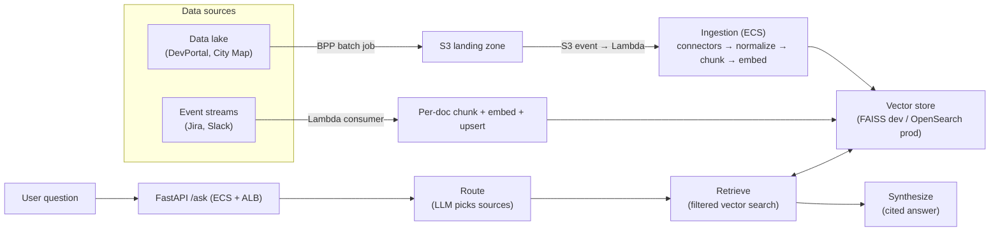

# How This Project Works — End to End

A plain-language walkthrough of the Intuit Assist agentic RAG system: how data travels
from Intuit's data lake and event streams, through AWS, into chunks and embeddings, and
finally out the other end as a citation-backed answer.

---

## The one-liner

> An agentic RAG knowledge assistant that answers engineers' questions over four internal
> sources — **Jira**, **Slack**, **DevPortal**, and the **City Map** capability graph.
> Data flows from the data lake and event streams through AWS ingestion into a vector
> index. At query time a LangGraph agent **routes** the question to the right sources,
> **retrieves** evidence, and **synthesizes** a cited answer.

---

## The big picture



---

## Part 1 — Getting data from the lake into the system

The four sources arrive through **two different paths**, chosen by how fast the data changes.

### Batch path — DevPortal + City Map (via BPP)

This data lives in **data lake tables** and changes slowly, so a scheduled full refresh is fine.

1. A **BPP batch job** (Spark) runs as the last step of the data pipeline. It projects the
   curated lake tables into a "rag-ready" dataset — rows shaped like
   `(doc_id, source, title, body, url, author, updated_at)`.
2. The job drops that dataset into an **S3 landing zone**
   (e.g. `s3://intuit-agentic-rag-docs/devportal/dt=2026-08-05/`).
3. The **S3 put event triggers a Lambda**, which kicks off the ingestion job — an **ECS task**,
   because embedding a full corpus outruns Lambda's 15-minute limit.

### Streaming path — Jira + Slack

These change constantly, and staleness hurts (a ticket closes, a new Slack answer appears).

1. Events flow through **Kafka / Kinesis**.
2. A **Lambda consumer** processes each event one at a time:
   normalize → chunk → embed → **upsert** into the vector store keyed by `doc_id`
   (delete the document's old chunks, insert the new ones).
3. Result: the index stays fresh within seconds instead of waiting for a nightly rebuild.

### Serverless is the glue

Lambda isn't a third data path — it's the **trigger mechanism** connecting the other two:
S3 events fire the batch re-ingestion, and event-source mappings drive the stream consumer.
This matches the Phase 6 plan in `infra/aws/README.md`.

---

## Part 2 — Normalization: the design decision everything hangs on

Four sources means four raw shapes: Jira tickets with comments, Slack threads with messages,
Markdown docs, and a JSON graph. Before anything touches the index, a **connector** per source
(`src/connectors/`) converts its raw form into one canonical schema
(`src/models/document.py`):

```python
class Document(BaseModel):
    id: str            # e.g. "jira:CAP-120"
    source: SourceType # jira | slack | devportal | city_map
    title: str
    body: str
    url: str
    author: str | None
    updated_at: datetime | None
    metadata: dict
```

Each connector flattens intelligently:

| Connector | What it does |
|---|---|
| **Jira** | Merges description + status + labels + comments into one body |
| **Slack** | One document per thread; messages joined as "user: text" lines |
| **DevPortal** | One document per Markdown file; first `# heading` becomes the title |
| **City Map** | Renders each graph node **plus its dependency edges** as readable text, so graph facts become searchable prose |

**Why this matters:** everything downstream sees only `Document` objects. A connector doesn't
mean "API client" — it's any adapter that implements `load() -> list[Document]`
(`src/connectors/base.py`). Swapping a local sample file for an S3 read, an Athena query, or
a stream event changes a couple of lines inside one connector and **nothing else**. That's
also how the project runs identically on a laptop (sample files in `data/sample/`) and in
production (lake + streams).

---

## Part 3 — Chunking and indexing

Chunking (`src/ingestion/chunking.py`) is **source-aware**, not one-size-fits-all:

- **Long DevPortal docs** → split into ~800-character chunks with 120-character overlap,
  preferring Markdown headings as split points so chunks align with sections.
- **Short Jira / Slack / City Map docs** → kept **whole**. Splitting a 5-message Slack
  thread destroys the Q&A context that makes it useful.
- **Every chunk carries metadata**: source, title, URL. This enables the two features that
  come later — source-filtered retrieval and clickable citations.

Chunks are embedded with OpenAI `text-embedding-3-small` and written to the vector store:

- **FAISS** locally (`data/index/faiss`) — simple, file-based, rebuilt from scratch each run.
- **OpenSearch** in production — because streaming upserts need per-document
  delete-and-insert, which a rebuild-only FAISS index can't do.

The full pipeline lives in `src/ingestion/pipeline.py`:
connectors → normalize → chunk → embed → save index.

```bash
python -m src.ingestion.pipeline
```

### One vector index or one per source?

All four sources go into **one shared vector index** — the source is recorded in each
chunk's metadata (`source: "jira" | "slack" | "devportal" | "city_map"`), and filtering
happens at **query time**, not by physical separation.

How the filter works today: FAISS is a pure similarity library with no native filtering,
so the retriever (`src/retrieval/retriever.py`) over-fetches and post-filters on the
chunk's `source` metadata, keeping only chunks from the sources the router selected.

The window **escalates** rather than being a fixed multiple of `k`. A fixed window is a
recall trap: when the routed sources are a small slice of the corpus, their chunks fall
outside the global top-N and vanish — so narrowing the route returns *less* evidence,
the opposite of what routing is for. The retriever widens the window (×3 each round,
bounded by index size) until it has `k` hits or the index is exhausted.
See `tests/test_retrieval.py` for the regression case.

In production, OpenSearch supports metadata filters *inside* the query, so the engine
applies the source filter during the search and the problem disappears entirely.

### Knowing when the answer isn't in the corpus

A vector index has no concept of "no match" — FAISS returns the `k` nearest neighbours
however distant they are. Ask "what is langchain?" and you still get six chunks about
capability registration, and the agent renders six citations that support nothing.

So the retriever applies a **relevance cutoff** (`relevance_threshold`, default `1.2`)
after filtering. On the sample corpus the separation is wide enough to be reliable:

| Question type | Best-match L2 distance |
|---|---|
| On-topic ("who owns Payments?") | 0.54 – 0.79 |
| Off-topic ("what is langchain?") | 1.35 – 1.77 |

When everything falls outside the cutoff the retriever returns nothing, and
`synthesize_answer` short-circuits to "I couldn't find relevant evidence" with **zero
citations** — before spending an LLM call. Honest refusal is a feature: a RAG system
that always answers is a RAG system that will confidently make things up.

Why one index instead of four:

| | Single shared index (chosen) | Per-source indexes |
|---|---|---|
| Cross-source questions | One ranked search; scores comparable (same embedding space) | Query N indexes, then merge lists whose scores aren't directly comparable |
| Operations | One thing to build, back up, monitor | N pipelines and indexes to manage |
| Adding a source | Just a new connector | New connector **and** new index infrastructure |
| When it wins | Default; keeps things simple | One source is far larger, updates far more often, needs its own security boundary or embedding model |

**Interview-ready summary:** "We use one shared index with source tags in chunk metadata.
Routing is a *query-time filter*, not a physical partition — which keeps cross-source
questions cheap and scores comparable. If one source grew to dominate or needed its own
security/update lifecycle, I'd split it into its own index and merge results, but that's
complexity you only take on when the data forces it."

---

## Part 4 — Query time: the agentic part

The API (`src/api/main.py`) is FastAPI — locally via uvicorn, in production on
**ECS Fargate behind an ALB** — exposing `POST /ask`. Each question runs through a
three-node **LangGraph** state machine (`src/agent/graph.py`):

```
route → retrieve → synthesize
```

A shared state (`src/agent/state.py`) flows through the nodes: question, chosen sources,
sub-queries, retrieved evidence, answer, citations.

### 1. Route (`route_sources` in `src/agent/nodes.py`)

An LLM reads the question against a description of what each source is good for
(ownership → city_map, how-to → devportal, tickets → jira, tribal knowledge → slack)
and returns JSON:

- which **1–3 sources** to search,
- optional **sub-queries** if the question is multi-part
  (e.g. "Who owns Payments and are there open tickets?" → two focused queries),
- a one-line **rationale**.

Defensive JSON parsing plus a fallback to `devportal + city_map` guard against malformed
LLM output — never trust raw LLM output as a control signal.

### 2. Retrieve (`retrieve_evidence` + `src/retrieval/retriever.py`)

Each sub-query hits the vector store **filtered to the routed sources**, concurrently
(sub-queries are independent I/O-bound searches). FAISS can't filter natively, so the
retriever over-fetches with an escalating window and post-filters on chunk metadata,
then dedupes results across sub-queries in a stable order.

### 3. Synthesize (`synthesize_answer`)

Evidence chunks are numbered `[1]`, `[2]`, … and the LLM is instructed to answer **only from
that evidence**, citing the numbers. The prompt encodes conflict-resolution rules:

- official **DevPortal** beats **Slack** tribal knowledge,
- **City Map** is authoritative for ownership facts.

Citations are narrowed to the evidence the answer actually cites (parsed from its `[n]`
markers, original indices preserved), so a two-source answer doesn't render `top_k` links.

The response returns the answer plus citations, chosen sources, sub-queries, and the routing
rationale — the agent's reasoning is fully inspectable.

---

## Local dev vs. production

| Concern | Local (this repo, today) | Production (target) |
|---|---|---|
| DevPortal / City Map data | Sample files in `data/sample/` | Data lake → BPP job → S3 landing zone |
| Jira / Slack data | Sample JSON files | Kafka/Kinesis events → Lambda consumer |
| Ingestion trigger | Manual `python -m src.ingestion.pipeline` | S3 event → Lambda → ECS task; stream events |
| Vector store | FAISS (full rebuild) | OpenSearch (incremental upserts) |
| API hosting | uvicorn on localhost | ECS Fargate + ALB |
| Monitoring | Logs | CloudWatch: latency, error rate, **ingestion lag** |

The local setup is a laptop-sized simulation of the production architecture — same code path,
different I/O at the edges.

---

## Why agentic instead of plain RAG?

Plain RAG searches one undifferentiated index, so a question about ownership gets polluted
with Slack chatter. The agent layer adds three things plain RAG can't do:

1. **Routing** narrows the search space per question.
2. **Sub-query decomposition** handles multi-part questions.
3. **Per-source authority rules** resolve conflicting evidence at synthesis time.

---

## Likely follow-up questions (and answers)

**"Why not query the lake directly at question time?"**
Latency and cost — Athena queries take seconds, and semantic search needs precomputed
embeddings. The lake is the system of record; the vector index is a purpose-built read
replica for retrieval.

**"How do you handle updates and deletes?"**
Everything is keyed by `doc_id`. Streaming upserts replace all chunks for a document
atomically; batch refreshes rebuild the affected partitions.

**"How do you evaluate it?"**
A golden question set (`data/eval/golden.json`) pairs each question with expected sources
and must-mention facts — checking both routing accuracy and answer content. LLM-as-judge
scoring is the next phase (Phase 5).

**"What about observability?"**
CloudWatch metrics on the three things that degrade silently: query latency, error rate,
and **ingestion lag** (time since a source's last successful sync — a stale index gives
confidently wrong answers).

**"What's real vs. planned?"**
Phases 0–4 (connectors, chunking, indexing, agent, API) are implemented and run locally with
sample data standing in for the lake. The AWS wiring (ECS, Lambda triggers, OpenSearch) is
scaffolded in `infra/` as the deployment target.

---

## Code map

| Path | Responsibility |
|---|---|
| `src/models/document.py` | Canonical `Document` schema all sources normalize into |
| `src/connectors/` | Per-source adapters: raw data → `Document` |
| `src/ingestion/chunking.py` | Source-aware chunking with metadata preserved |
| `src/ingestion/pipeline.py` | Connectors → chunk → embed → FAISS index |
| `src/retrieval/retriever.py` | Vector search with source filtering |
| `src/agent/` | LangGraph: route → retrieve → synthesize |
| `src/api/main.py` | FastAPI `POST /ask` endpoint |
| `src/config.py` | Settings from `.env` (models, chunk sizes, AWS placeholders) |
| `data/sample/` | Stand-in data for all four sources |
| `data/eval/golden.json` | Golden Q&A set for evaluation |
| `infra/` | Docker + AWS (ECS, S3, Lambda, OpenSearch) scaffolding |
