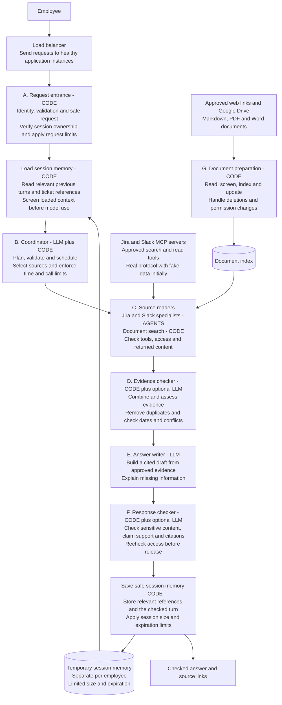

# High-level design 2: workflow with explicit session memory

Created September 30, 2026. **Status: alternative design for comparison, not implemented.**

This page preserves the proposed workflow with explicit memory steps. The
[original high-level design](high-level-design.md) remains available unchanged so
we can decide later which presentation to use. This is a second design page,
not a replacement for the original or a requirement for separate microservices.

## What the project does

An employee asks an engineering question. The assistant finds information in
Jira, Slack and approved documents, then explains it with supporting links.
It remembers relevant context within the employee's temporary conversation so
follow-up questions make sense. It must explain missing information rather than
invent an answer.

We begin with real local MCP protocol connections backed by realistic fake Jira
and Slack data. Document retrieval is required and supports approved web content,
Google Drive, Markdown, PDF and Word documents as their adapters are implemented.

## Workflow

The main arrows follow a question through one application instance. The load
balancer chooses a healthy instance; it does not distribute individual workflow
steps between instances. The source arrows show returned information: C calls
the MCP servers and document index, then receives their results.

G runs separately in the background. Documents are prepared before questions
arrive, and approved changes are processed incrementally.

## What the labels mean

| Label | Meaning | Example in this workflow |
|---|---|---|
| CODE | Programmed rules determine what happens | Identity checks, memory loading, permission enforcement |
| LLM | A bounded language-model task | Proposing a search plan or writing a draft |
| AGENT | A model chooses tools, observes screened results and may make a bounded follow-up call | Jira and Slack specialists |
| Storage cylinder | Information saved outside an individual function call | Session memory and document index |

LangGraph coordinates the memory steps and B–F, including source-reader branches
and controlled retries. It is the execution framework around the steps, not an
additional source of information. Optional model assessments do not grant access;
permissions and execution limits are enforced by code.

## Follow one conversation

First question: **"Why is PAY-123 delayed?"**

1. The load balancer sends the request to a healthy application instance.
2. A checks identity, request validity, session ownership and capacity.
3. Load session memory retrieves and screens any relevant prior context. A new
   conversation starts with no earlier turns.
4. B plans the search; C obtains approved ticket/discussion evidence through MCP.
5. D checks the evidence, E drafts the explanation, and F checks the response.
6. Save safe session memory records relevant references such as PAY-123 and the
   checked turn, then the application returns the answer with citations.

Follow-up: **"Who owns it?"**

The memory step supplies the earlier PAY-123 reference so the coordinator can
understand "it". The source reader retrieves current ownership evidence. The
previous generated answer is not treated as proof of the current owner.

## Memory and guardrail rules

- Session context belongs to the authenticated employee and has configurable
  size and expiration limits. Long-term personal memory and saved cross-session
  history remain outside the initial scope.
- Check permission before reading session state; screen loaded context before
  model use. Store only approved context, not credentials or unchecked tool replies.
- Source readers use approved read tools and company-wide eligible information.
  Raw results are screened before entering a model prompt or saved workflow state.
- Time, call and token budgets bound all source work, retries and refinement.
- Source failures stay distinguishable from successful searches with no evidence.
- The proposed response mode sends safe progress immediately and releases answer
  text only after checking its draft. This remains a proposed change to raw-token streaming.

The diagram shows the normal successful path. Denied requests stop early; missing
evidence and unavailable sources produce safe errors or clearly limited answers.
A failed response check never reaches memory saving as an approved answer.
If saving memory fails, the checked answer can still be delivered; record the
failure and make lost follow-up context clear. If memory cannot be loaded for an
ambiguous follow-up, ask for the missing reference rather than guessing.

## Connection to the LLD

The A–G responsibilities still match the [existing LLD](low-level-design.md).
This version makes session memory visible as two explicit steps; their complete
method walkthroughs would be added to the LLD if we choose this presentation.
Existing session ownership is explained under
[authorize_session](low-level-design.md#authorize_session), and the detailed
[session service reference](service-reference.md#9-session-cache-and-metadata-service--g09-g15-g19)
already proposes loading and saving safe context.

## Compare with the original

| Topic | Original HLD | HLD 2 |
|---|---|---|
| A–G components | Present | Same responsibilities preserved |
| Load balancer | Present | Preserved |
| Component purpose labels | Present | Preserved and expanded |
| Memory in the diagram | Discussed in supporting text | Explicit load/store/save steps |
| Agent versus code labels | Explained in text | Shown directly inside the boxes |
| Document and MCP connections | Present | Preserved |

Neither diagram proves production readiness or million-request capacity. Traffic
targets, session expiration and production configuration remain open decisions.
