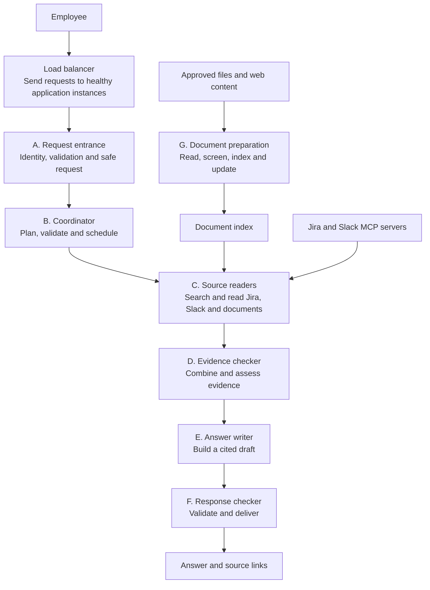

# High-level design: the main parts

Read the [project story and workflow](../workflow.md) first. This is a proposed
design; it does not mean the new features have been implemented.

## What HLD means

HLD answers: **What are the main parts, what does each part own, and how do they connect?**
It does not require a list of every class, database field or exception.

We use the same letters and names as the workflow and the
[LLD](low-level-design.md). Each LLD section opens one HLD box.

Arrows show the direction of request progress or information flow. The source
reader calls its sources and receives their results. The document-preparation
path operates separately from the employee's question.

## Where the load balancer fits

The load balancer is the front door before A. It sends each incoming request to
one healthy running copy of the application, called an **instance**. Each copy
contains the same A–F workflow. It does not send A to one instance and B to another.

For example, with three application instances, the load balancer distributes new
requests among the healthy instances. If one becomes unhealthy, new requests go
to the others. A failed in-progress request is not automatically resumed elsewhere.

This helps us add application capacity later. Jira, Slack and model-provider
limits still apply across all instances. Locally we can start one application
instance; the production layout places a load balancer in front of multiple copies.
Its configuration is explained in the [LLD](low-level-design.md#load-balancer-before-a).

## The direct HLD-to-LLD connection

| HLD part | Its single main responsibility | Opens into this LLD section |
|---|---|---|
| **Load balancer** | Route incoming requests to healthy application instances | [Infrastructure before A](low-level-design.md#load-balancer-before-a) |
| **A. Request entrance** | Receive an authorized, safe question | [A: identity, validation and safe request](low-level-design.md#a-request-entrance) |
| **B. Coordinator** | Decide and control which work is needed | [B: plan, validate and schedule](low-level-design.md#b-coordinator) |
| **C. Source readers** | Collect approved information from selected sources | [C: Jira, Slack and document calls](low-level-design.md#c-source-readers) |
| **D. Evidence checker** | Decide what the collected information supports | [D: combine and assess evidence](low-level-design.md#d-evidence-checker) |
| **E. Answer writer** | Explain supported information | [E: build a cited draft](low-level-design.md#e-answer-writer) |
| **F. Response checker** | Release only a checked response | [F: validate and deliver](low-level-design.md#f-response-checker) |
| **G. Document preparation** | Keep approved documents searchable | [G: read, screen, index and update](low-level-design.md#g-document-preparation) |

These names describe responsibilities. A part can contain several functions, and
several parts can live in one Python application. We are not starting with seven
independent microservices.

## Where the technologies belong

| Technology or idea | Where it fits | Why it is there |
|---|---|---|
| Load balancer | Before A | Distributes requests across healthy copies of the application |
| FastAPI | A and delivery from F | Receives questions and returns responses |
| LangGraph | Coordinates B through F, with input screening before model use | Runs steps, branches and controlled agent loops |
| LLM: a language model | Planning in B, decisions inside Jira/Slack in C, writing in E | Interprets questions and language |
| MCP | Jira/Slack connections inside C | Calls search/read tools on another server |
| Document index | Built by G, searched by C | Avoids processing every file for each question |
| Guardrails | Throughout A–G | Enforces access, data-handling and execution limits |

LangGraph is the execution framework around these steps. It is not an additional
source of knowledge, and it does not automatically supply the security checks.

## What we store

Keep these four concepts separate:

- **Document knowledge:** approved passages, search data and source links, prepared by G.
- **Working request state:** the current question, selected tasks and safe results used by LangGraph.
- **Temporary conversation context:** enough to understand a follow-up such as "Who owns it?", isolated per employee.
- **Operational records:** timings, failures and security decisions used to operate the service.

A saved answer is not an authoritative source. New follow-up questions still need
fresh supporting evidence. Answer caching is a later optimization with explicit
freshness and permission checks.

## What the reader needs to remember

The question path is **load balance -> receive -> coordinate -> find -> check evidence -> write -> check response**.
The background path is **prepare documents -> make them searchable**.
The [LLD](low-level-design.md) opens those same parts one by one.

Deployment topology, shared quotas, retention, recovery and release gates remain
in the [production reference](production-reference.md). Concrete open issues and
tests remain in the [gap register](gap-register.md). They are essential engineering
work, but are not prerequisites for understanding the main workflow.
