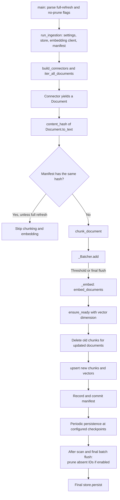
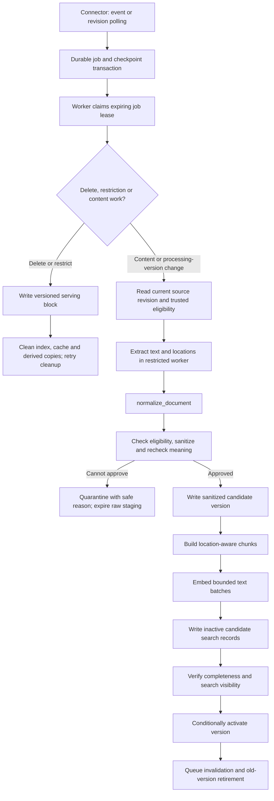
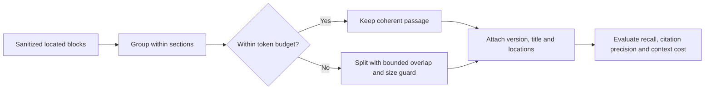
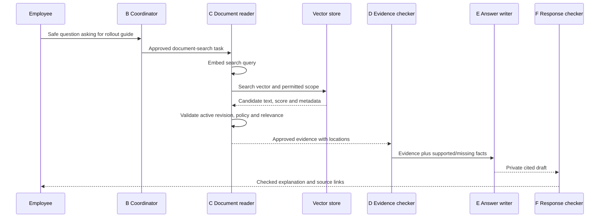

# Document ingestion LLD: from a source file to a cited answer

Updated October 1, 2026. This opens **G. Document preparation** and its connection
to **C. Source readers** and **E. Answer writer** in the
[main LLD](low-level-design.md#g-document-preparation). All example records are fake.
**Current code** means inspected repository behavior. **Proposed** means a design
to implement and evaluate, not a feature already available.

## 1. What kind of ingestion do we have?

Ingestion means preparing source content so that later questions can search it.
It includes reading, normalizing, chunking, embedding and storing documents.
It does not mean generating answers or training the language model.

| Mode | What happens | Project status |
|---|---|---|
| Initial batch / backfill | Scan the selected corpus and build its first index. | Current CLI can run an initial finite scan. |
| Incremental batch | Scan again; compare hashes; skip unchanged documents; process changed/new ones. | Current default in `run_ingestion()`. Still enumerates sources on every run. |
| Full refresh | Ignore unchanged-content skips and re-embed the scanned corpus. | Current `--full-refresh`; does not by itself provide a safe blue/green rebuild or model migration. |
| Lazy iteration | Yield records one at a time instead of assembling the full corpus up front. | Current connectors/pipeline use iterators, with exceptions and memory limits described below. |
| Continuous incremental processing | Source events or revision polling create durable jobs; workers process only affected records. | Proposed production path. Polling frequency/source-to-search lag remains to be set. |
| Live retrieval | Fetch selected records when an employee asks a question. | Proposed Jira/Slack MCP path; this is not document ingestion. |

The word **streaming** in the current pipeline describes Python iteration. It
does not establish a live event stream, a message broker or continuous ingestion.
Source events and polling are alternatives per connector; an event is a signal
to re-read trusted current metadata, not proof that its payload is safe/current.

In the proposed version, Jira and Slack primarily use live MCP reads; web pages,
Drive items, Markdown, PDF and Word documents use the document pipeline. A new
Jira update does not require re-embedding a full Jira archive before answering.
Live sources introduce latency and rate limits that the MCP adapter must handle.

## 2. Current code: follow one finite ingestion run



The per-document path repeats until the connector iterator is exhausted; skipping
one unchanged record does not end the run. The code calls periodic persistence
after batch manifest commits; after the scan, it flushes the batch, prunes when
enabled, and calls final `store.persist()`.
The delete-before-upsert and commit-before-persist order are known gaps, not a
recommended publication algorithm.

| Existing method | What it does and how |
|---|---|
| `build_connectors()` | Constructs Jira, Slack, DevPortal and City Map readers. These produce the same `Document` schema. |
| `iter_all_documents()` | Iterates connectors in order and yields their records; it does not ask a model which connector to ingest. |
| `Document.to_text()` | Builds `[SOURCE] title` followed by the body. This is the text hashed and chunked. |
| `content_hash()` / `manifest.is_unchanged()` | SHA-256 fingerprint comparison by document ID. Matching text skips embedding. Metadata-only permission changes are not detected by this hash. |
| `chunk_document()` | Materializes the chunks for one Document so the batcher knows its chunk count. |
| `_Batcher.add()` | Appends all chunks of a document, records pending metadata and flushes when the accumulated count reaches the threshold. |
| `_embed()` | Calls `embeddings.embed_documents(texts)`; on an exception retries up to four total attempts, sleeping 2, 4 and 8 seconds before the later attempts. It currently retries broad exceptions, not only classified transient errors. |
| `_Batcher.flush()` | Embeds, initializes index dimensions if needed, deletes replaced records, upserts, commits manifest progress and periodically persists the store. |
| `manifest.vanished()` / `delete_docs()` | Finds previously known IDs missing from this run and removes their chunks when pruning is enabled. Correctness requires complete enumeration of the same scope. |
| `store.persist()` | Saves local FAISS data; server-backed OpenSearch persistence is handled by that service. |

**Memory caveat:** the batch threshold defaults to 256 chunks, but it is not a
hard maximum: one large Document's chunks can push the batch beyond it. The
`seen` set also grows with document count; individual extractors and the FAISS
index consume memory. The current pipeline is not constant-memory in corpus size.

## 3. How is an ingested Document created?

The connector creates a Python data object from source content. It does not ask
an LLM to invent a document. A file, a ticket or a bounded page group can each be
a source record; identity and citation location must remain traceable.


**Current example — `DevPortalConnector.iter_documents()`:** it reads local
`*.md` files, uses the first `# ` heading or a filename-based fallback for the
title, and yields this shape:

```json
{
  "id": "devportal:rollout-guide",
  "source": "devportal",
  "title": "Payments rollout guide",
  "body": "# Payments rollout guide\n\n## Release checks\nThe release test must pass.",
  "url": "https://devportal.example.com/docs/rollout-guide",
  "author": null,
  "updated_at": null,
  "metadata": {"path": "rollout-guide.md"}
}
```

The example URL is synthetic. A real connector must preserve the canonical
source link rather than constructing a plausible but nonexistent citation.
The current `SourceType` enum contains `jira`, `slack`, `devportal`, `city_map`;
adding Drive/web identities requires an explicit schema/adapter decision.

`to_text()` produces:

```text
[DEVPORTAL] Payments rollout guide

# Payments rollout guide

## Release checks
The release test must pass.
```

**Proposed general normalization:** `normalize_document()` receives a stable
source identity, revision, extracted blocks and a verified source link. It
constructs a normalized record and validates required fields. Do not use a
mutable filename alone as identity for Drive, or discard page/heading locations
by flattening text too early. Keep source type separate from file format: a
Drive item can contain a PDF, Word file or native Google document.

| Input format | Read/extract plan | Current support and remaining work |
|---|---|---|
| Markdown | Read text and preserve headings/code blocks. | Local DevPortal Markdown reader exists; stronger location preservation is proposed. |
| Web/HTML | Fetch an approved URL with redirect/size checks, then remove navigation and preserve main text/headings. | Local HTML extractor exists; that alone is not a safe web crawler/change tracker. |
| Google Drive | Enumerate approved folders/items with trusted metadata; export native documents or download supported files; preserve item ID/revision. | Production Drive adapter, credentials, change feed and permission-change handling are proposed. |
| Digital PDF | Extract page text and retain page numbers; large files may be grouped into bounded page records. | `pypdf` extraction and page markers exist. Whole-file and page-group routines have different memory behavior. |
| Scanned PDF | Detect lack of usable text; run approved OCR only when enabled, otherwise report unsupported input. | OCR is not established in this code. Never silently treat an unreadable scan as deletion. |
| Word `.docx` | Parse paragraphs, headings and tables with location metadata; isolate parser resources. | Proposed parser; no Word extractor is evidenced in the current dispatch. Legacy `.doc` needs separate support. |
| CSV/sheets | Keep useful column names with values; use row records for small reference data and profiles/bounded samples for large sheets. | City Map/extraction code has these strategies; profiling is deterministic processing, not LLM answer synthesis. |

## 4. Proposed background ingestion workflow



Record durable jobs before advancing source cursors. If job and checkpoint
records cannot share a transaction, use a durable outbox plus reconciliation;
an outbox is a record of work to dispatch later. Re-delivery is expected, so
jobs use stable identities and repeatable writes. A worker crash lets another
worker reclaim an expired lease; it must not create duplicate active versions.

### The lifecycle of one guide revision

| Stage | What is stored | Example |
|---|---|---|
| Source reference | Source ID/revision, scope and change type | guide-17, revision 2, content update |
| Restricted staging | Temporary raw bytes under tight access and retention | downloaded PDF; never normal logs or a model prompt |
| Sanitized version | Approved text/locations and processing versions | guide-17:v2 with eligibility/redaction versions |
| Candidate chunks | Version-specific IDs, safe text, location and vectors | guide-17:v2#3, section Release checks, page 4 |
| Active metadata | Authoritative pointer/generation and serving-block status | guide-17 -> v2, generation 8 |
| Search hits | Candidate records returned by search, validated against active metadata | v1 hit discarded; active eligible v2 accepted |

Track content hash, source revision, eligibility version, redaction version,
parser version, chunker version and embedding configuration separately. A text
hash alone cannot express all reasons to reprocess or exclude a record.

## 5. Chunking strategy: what we do and why

Chunking limits how much text is embedded/retrieved together. Very small chunks
can lose meaning; very large chunks dilute relevance and consume answer context.
Overlap repeats a little nearby text to reduce boundary loss, at extra storage
and embedding cost. It does not guarantee a complete sentence or table.

**Current code:** `RecursiveCharacterTextSplitter` uses 800 **characters** with
120-character overlap. It tries separators in this order: level-two Markdown
heading, level-one heading, paragraph, newline, space. This is a boundary
preference, not a full structural parser or a hard token-limit guarantee.
Short Slack/Jira/City Map records stay whole if their `to_text()` length is at
most the configured chunk size; longer records are split too.

Current chunk IDs are `document_id#position`. Each chunk keeps content, document
ID, source, title, URL, scalar metadata and author. Split chunks also get a chunk
index. Source `updated_at` is not automatically propagated by this code, and
page markers alone do not create a complete structured location contract.

**Proposed strategy, to evaluate rather than assume optimal:**

1. Extract blocks with heading paths, page locations and table/code boundaries.
2. Group nearby blocks from the same section; retain title/heading context.
3. Enforce the embedding model's token limit with its matching tokenizer.
4. Split oversized prose at paragraph/sentence boundaries, then use bounded
   overlap. Handle a giant token/line with an explicit final size guard.
5. Preserve table headers with row groups and avoid splitting short code examples.
6. Attach exact block/page spans and a version-specific chunk ID to every output.



Keep the existing defaults as a reproducible baseline. Compare alternative
token-sized configurations using the same labeled questions; measure boundary
cases, table questions, exact identifiers and overlapping duplicate hits. Do
not change chunk sizes purely because a tutorial uses a different number.

## 6. Document embeddings and query embeddings

An embedding service converts text into numbers. The vector is not an answer,
and this step does not fine-tune the model.

| Step | Current call | What is sent / returned |
|---|---|---|
| Ingestion | `OpenAIEmbeddings(...).embed_documents(texts)` through `_embed()` | List of chunk contents -> one vector per text |
| Question search | `embed_query(query)` or `aembed_query(query)` | Search query -> one vector |
| Store initialization | `ensure_ready(len(vectors[0]))` | Vector dimension -> compatible index setup |
| Store write | `upsert(chunks, vectors)` | Aligned text/metadata records and vectors -> written count |

The configured default embedding model is `text-embedding-3-small`; configuration
is not proof of a deployed model. The proposed pipeline sends only screened
text to an approved embedding environment. Validate vector count/order, dimension
and finite values before writes. Bound batches by both number of chunks and total
tokens/bytes; classify retryable errors and honor the job deadline.

Use compatible document/query embedding configurations. Changing model or
dimensions requires a new index/version, re-embedding from approved text and
coordinated query cutover; equal dimensions alone do not mean compatible vectors.
Do not mix embeddings from unrelated models in the same searchable space.

## 7. Which vector store is used, and why?

**The repository default is FAISS.** `get_vector_store()` selects FAISS or
OpenSearch from `VECTOR_STORE`. We retain FAISS for the first small local exercise
because it is already integrated and needs no separate search service.
OpenSearch is the existing candidate for a shared service; no production-scale
capacity claim follows from selecting it.

| Topic | Current FAISS implementation | Current OpenSearch implementation |
|---|---|---|
| Process/storage | Index and chunk metadata loaded into the app process, saved to local files | Client connects to an independently running search service |
| Similarity search | Exact inner product over normalized vectors using `IndexFlatIP` | Approximate HNSW vector index configured in the backend |
| Source filtering | Over-fetch candidate neighbors, then filter in Python | Backend query filters |
| Keyword search | Not implemented in this backend | Optional BM25 plus vector rankings combined by rank fusion |
| Useful starting case | Small local corpus, simple setup and a correctness baseline | Shared search, keyword/semantic retrieval, managed operational possibilities |
| Limits to address | RAM use, persistence coordination, read/write consistency and multiple app replicas | Authentication/TLS, mappings, shard/replica sizing, refresh behavior, monitoring and benchmarked recall/latency |

The shared `VectorStore` interface provides `ensure_ready`, `upsert`,
`delete_docs`, `search`, `count` and `persist`. In code, search hits use a
cosine-like relevance score where higher means closer; hybrid **rank ordering**
and that **similarity score** are different concepts.

A vector store is not the session store or source of authorization. The proposed
metadata store decides active revisions and exclusions. The sanitized content
store supports rebuilds; the vector index is a derived searchable representation.
For a local worker/app split, publish a complete FAISS snapshot and reload it
safely; an API instance already holding an index does not magically see file changes.

Before growth, compare measured retrieval quality, corpus bytes, update rate,
filtering, memory, p95 latency and recovery cost. A million requests or a billion
chunks requires workload definition and load tests, not a backend-name change.

## 8. How the index becomes an answer



**Current retrieval:** `SourceRetriever` embeds the query, searches the backend
with selected source labels and filters by similarity (defaults: `top_k=6`,
`min_similarity=0.28`). It returns `RetrievedChunk` objects. These small-corpus
defaults need evaluation. Over-fetch/refill after policy filtering must be
bounded so rejected hits do not cause either unlimited searches or silent loss
of all relevant approved candidates.

**Current synthesis:** `_evidence_prompt()` numbers the retrieved passages and
builds a citation list; `synthesize_answer()` calls the answer model and
`_cited_only()` filters citation markers. With no retrieved evidence, `_refused()`
returns a fixed response without an answer-model call. There is no ingestion-time
LLM summary required by this design. The proposed D/F checks add claim support,
freshness/conflict handling and release policy to this current path.

## 9. Updates, deletion and crash recovery

Proposed publication keeps eligible v1 active while v2 is built. After v2 is
durable, complete and visible to search, a conditional metadata update switches
the active version only if the expected generation and current policy still
match. Record cleanup/cache-invalidation work durably with activation when
possible; reconcile incomplete cross-store operations. Search validates hits
against current metadata even if old candidates are still physically indexed.

| Event/failure | Required behavior |
|---|---|
| Unchanged text, unchanged processing versions | Skip embedding. |
| Permission restriction with identical text | Block serving immediately upon verified detection; do not wait for a new embedding. |
| Delete event | Write a versioned tombstone, meaning a serving-block record; then retry physical cleanup separately. |
| Partial source listing or corrupt file | Report incomplete work; do not infer disappearance/deletion from it. |
| Duplicate or older event | Re-read current source state or compare monotonic revisions; never reactivate a revoked record using stale work. |
| Embedding or partial index write fails | Candidate remains inactive; retry idempotently. Preserve eligible active version. |
| Crash after active-pointer change | Durable outbox/reconciliation resumes cleanup and invalidation. Retrieval still enforces the active pointer. |
| Policy store unavailable | Withhold affected results; an old index filter cannot authorize release. |
| Restore from backup | Reapply current tombstones/policy before opening serving traffic. |

Current gaps include deletion before replacement upsert, manifest commit before
FAISS persistence, and pruning without a formal scope-completeness contract.
Do not describe current resume behavior as a transactional or exactly-once
guarantee. Retry-safe versioned publication is work still to implement.

## 10. Files, proposed additions and acceptance checks

| Existing file | Read it to understand |
|---|---|
| [`document.py`](../../src/models/document.py) | Document fields and embedding text |
| [`devportal.py`](../../src/connectors/devportal.py) | A simple Markdown-to-Document conversion |
| [`extractors.py`](../../src/ingestion/extractors.py) | Format-specific extraction |
| [`chunking.py`](../../src/ingestion/chunking.py) | Source-aware current chunking |
| [`pipeline.py`](../../src/ingestion/pipeline.py) | Scan, skip, batch, embed, write and prune |
| [`manifest.py`](../../src/ingestion/manifest.py) | Content hashes and saved progress |
| [`factory.py`](../../src/vectorstore/factory.py) | Backend selection |
| [`retriever.py`](../../src/retrieval/retriever.py) | Query embedding and evidence retrieval |
| [`nodes.py`](../../src/agent/nodes.py) | Current evidence prompt and synthesis |

Proposed modules stay under `src/ingestion/` for normalization, source change
jobs, safe extraction and publication; shared eligibility/sanitization belongs
under `src/policy/`. Add fields to source/chunk/evidence contracts together so
policy/location metadata survives the entire pipeline.

Use fake clean/secret-bearing/restricted files, changed permissions with identical
text, duplicate events, a shorter revision, broken PDFs, long headings/tables,
empty extraction, failed embeddings and worker crashes at publication boundaries.
Verify: no unsafe indexing, unchanged skips, correct citations, no stale-version
serving, no deletion after partial enumeration, and replay recovery. Measure
source-to-search lag, queue age, extraction failures, chunk/token counts, embedding
cost, recall and query latency before changing defaults.

**Understanding check:** If text is unchanged but access becomes restricted, why
must hash skipping not win? Which stage creates the Document, which produces
numbers, and which writes the employee's final answer?
