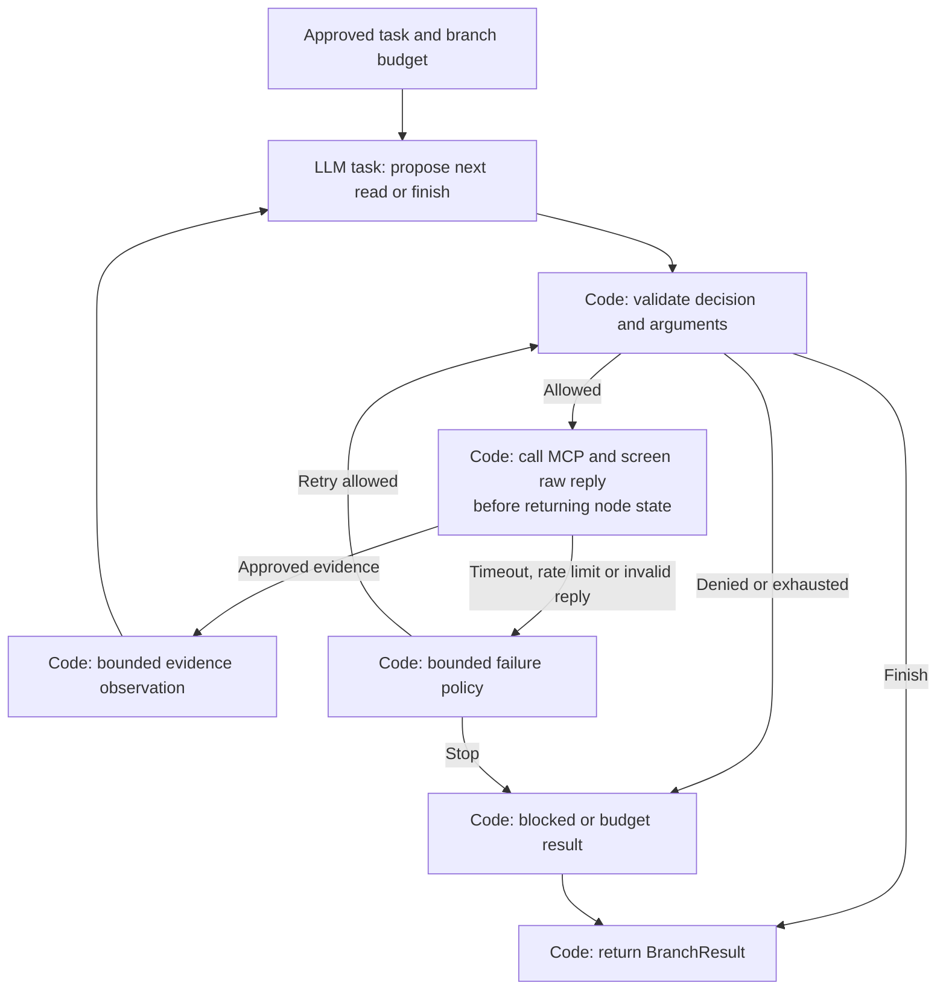

# LangGraph: which nodes are agents?

Status: proposed node design. The existing graph is still `route -> retrieve -> synthesize`.

This is a detailed reference. Start with the [plain-language workflow](../workflow.md)
and [HLD](high-level-design.md). Their parts map to these implementation node names:

| Part used in the introductory HLD/LLD | Nodes or responsibilities on this page |
|---|---|
| A. Request entrance | API authentication, session checks and `screen_input` |
| Explicit memory steps in LLD / HLD 2 | `load_session_context` before planning; `save_session_context` during finalization |
| B. Coordinator | `plan`, `validate_plan`, source scheduling and `refine_plan` |
| C. Source readers | `jira_branch`, `slack_branch`, `documents_branch` and their tool/result gates |
| D. Evidence checker | `merge_evidence` and `assess_evidence` |
| E. Answer writer | `compose_answer` and `compose_limited` |
| F. Response checker | `validate_output`, `finalize` and public response release |
| G. Document preparation | Separate ingestion workers; not part of the question graph |

`lookup_cache` is a later shortcut: any reused answer still passes F's current
policy checks. It is left out of the introductory diagram to keep the normal path clear.

## 1. Terms used in this project

An **ordinary-code node** follows programmed rules. An **LLM task node** makes a
bounded model call for a specific output. An **agent subgraph** lets a model choose
a tool, observe its screened result, and choose another action within fixed limits.
Calling an LLM once does not automatically make a node an autonomous agent.

The planner and answer writer were previously called agents informally. In this
design they are LLM tasks. The Jira and Slack specialists are the two tool-using
agents. Document retrieval and security decisions are ordinary code, possibly
supported by approved classifiers. These are intentional project definitions.

LangGraph supports graphs containing both ordinary functions and LLM operations;
workflows and agents are distinguished by how their execution decisions are made.
See the official [workflows and agents guide](https://docs.langchain.com/oss/python/langgraph/workflows-agents).

## 2. Node inventory

| Proposed node | Kind | What it does in short | Model/tool access |
|---|---|---|---|
| API authentication | Ordinary code, outside graph | Validates employee and session ownership | Identity provider only |
| `screen_input` | Ordinary code + optional approved classifier | Produces safe question/context or blocks | Policy service; classifier only in approved environment |
| `load_session_context` | Ordinary code | Reads owner-bound temporary context, rechecks dependencies, screens and bounds it | Session and policy stores; no source tools |
| `lookup_cache` | Ordinary code | Checks exact eligible cache entries and dependency versions | Cache and metadata |
| `plan` | LLM task | Proposes source tasks and focused queries | Model only; no source tools |
| `validate_plan` | Ordinary code | Enforces schema, source scope and budget | Policy and budget ledger |
| `jira_branch` | Agent subgraph wrapper | Searches/reads Jira until sufficient or budget ends | Jira read tools through gate |
| `slack_branch` | Agent subgraph wrapper | Searches/reads Slack until sufficient or budget ends | Slack read tools through gate |
| `documents_branch` | Ordinary-code workflow | Searches eligible indexed documents and returns evidence | Search gateway; embedding/reranking services if configured |
| `merge_evidence` | Ordinary code | Joins all branch envelopes and removes duplicates | No model required |
| `assess_evidence` | Ordinary code + optional LLM task | Checks coverage, dates and conflicts; proposes supported claims | Model assessment cannot override policy |
| `refine_plan` | LLM task | Proposes one additional focused search round | Model only; must pass `validate_plan` again |
| `compose_answer` | LLM task | Writes a draft from approved evidence and supported claims | Model only; no tools |
| `compose_limited` | Ordinary code | Builds an explicit no-answer/unavailable/partial message | No model required |
| `validate_output` | Ordinary code + optional LLM task | Checks sensitive content, citations and support | Policy; optional support-assessment model |
| `finalize` | Ordinary code | Rechecks revocations, commits approved response and safe session update | Metadata, session/cache, audit |
| Response release | Ordinary code, outside graph | Serializes only approved public events | SSE transport |

A classifier/judge produces an advisory signal with its own error/timeout outcome.

`save_session_context` is a code helper within `finalize`, not another agent. It
writes only approved bounded context against the expected session version. Failure
to save does not turn a checked answer into an unsafe draft or discard it; expose
a safe follow-up-context limitation. See the
[memory method walkthroughs](low-level-design.md#session-memory-between-a-and-b-and-after-f).
Missing eligibility proof or a denied tool call cannot be overridden by an LLM.
If mandatory screening is unavailable, affected content is withheld.

## 3. Detailed source-agent loop



The whole loop is the agent. `DECIDE` alone is an LLM task; `CALL` is ordinary code.
Searching and reading are real MCP calls to our local fake-data server first.
The MCP server is not itself an LLM agent and does not compose the answer.

Combine raw execution and screening inside one node boundary. A split into a
raw-return node and a later screening node would risk persisting raw source text
in intermediate state. Disable automatic raw tool tracing and emit sanitized events.

## 4. State and parallel results

Use typed state and explicit update rules. Application validation happens at
external/model boundaries; type annotations alone do not enforce runtime policy.

```text
RunState
  request_id, session_ref, policy_version
  safe_question, safe_context
  approved_plan, round_number, deadline_at
  branch_results: map[(round_number, source), BranchResult]
  evidence: map[evidence_id, Evidence]
  source_limitations, coverage, conflicts
  draft_ref, approved_response, terminal_status
```

Tokens, credentials, raw documents, unrestricted tool replies, and hidden model
reasoning must not enter this state. Only selected safe fields enter model prompts.
An unchecked draft remains in short-lived private memory via `draft_ref`; it is
not included in durable checkpoints, normal logs or outward graph events. Resume
regenerates a missing draft under the remaining request budget.

For the initial three-source topology, the validated plan activates three wrapper
nodes in parallel. A wrapper for an unselected source returns `skipped` without
calling any tool or model. A multi-predecessor join waits for all three wrappers;
selected-source failures return typed outcomes. Cancellation stops the whole run.
This fixed topology makes the join understandable before introducing dynamic fan-out.

Each wrapper returns a delta for its own `(round, source)` key. A reducer merges
disjoint keys, accepts identical replayed outcomes, and rejects conflicting writes
to the same completed branch key. Never have parallel nodes return a whole stale
copy of parent state. The parent owns round increments and answer generation.

LangGraph state, reducers, nodes and conditional edges provide these building
blocks; they do not automatically enforce our budget or data policy. See the
[Graph API](https://docs.langchain.com/oss/python/langgraph/graph-api).

## 5. Edges and termination

```text
START -> screen_input
blocked input -> compose_limited -> validate_output -> finalize -> END
allowed input -> load_session_context -> lookup_cache
ambiguous follow-up with unavailable context -> compose_limited
valid cache -> validate_output -> finalize -> END
miss or invalid cache -> plan -> validate_plan
invalid plan -> compose_limited
valid plan -> [jira_branch, slack_branch, documents_branch] -> merge_evidence
merge_evidence -> assess_evidence
sufficient/partially supported -> compose_answer -> validate_output
insufficient and refinement available -> refine_plan -> validate_plan
insufficient with exhausted budget -> compose_limited -> validate_output
failed output validation -> safe fixed limitation response -> finalize -> END
```

Refinement is limited to one extra round initially. The original request deadline,
tool and token budgets cover every branch, retry, evaluator and refinement call;
they are never reset by a new node or round. Graph recursion limits are an additional
backstop, not a replacement for budgets. No automatic output-repair loop initially.

If a required source failed, a partial answer describes only supported parts and
the missing source. A search failure never turns into a claim that no records exist.

## 6. Persistence, replay and events

Checkpoints support recovery only when configured with an appropriate backend.
Use owner-bound session/run identifiers, short retention and protected access.
Persistence does not guarantee exactly-once external tool execution. A replayed
read may cost another call or see a newer revision: record observation timestamps,
recheck permission and account for calls through an idempotent budget ledger.
Store the safe result when available; an uncertain attempted call retains its
budget charge and a retry consumes a new reservation.

The official [persistence guide](https://docs.langchain.com/oss/python/langgraph/persistence)
describes checkpoints. We must still implement safe replay and retention rules.

Do not proxy LangGraph state/token streams directly to the browser. Public events
are explicitly serialized: started, searching, checking, done, safe error. Status
events omit raw arguments, questions, evidence previews and model reasoning. After
validation, the checked answer may be sent as a final payload or checked text chunks.
This is not raw model-token streaming and remains a proposed UX change.

## 7. One worked trace

Question: "Why is PAY-123 delayed, what is its status, and where is the rollout guide?"

1. API validates the employee; input screening produces safe request context.
2. Planner proposes Jira ticket lookup, Slack discussion search and document guide search.
3. Code checks the three tasks and reserves request/branch budgets.
4. Jira agent reads PAY-123; Slack agent searches then reads a relevant thread.
   Each observation passes eligibility and sanitization before the next model call.
5. Document code finds guide passages with title, revision, URL and section/page.
6. The join receives all three outcomes; merge preserves their different timestamps.
7. Assessment identifies supported status/reason/guide claims or gaps.
8. Answer writer creates a private draft; output checks validate claims and links.
9. Finalization rechecks current revocations and publishes the approved response.

If Slack times out, steps 6-9 can produce a partial answer that says the discussion
could not be checked. If eligibility checks are unavailable, the affected evidence
is withheld even if it would make the answer more complete.
