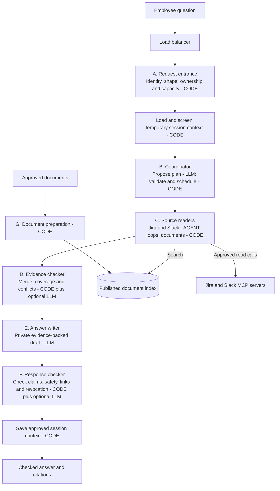
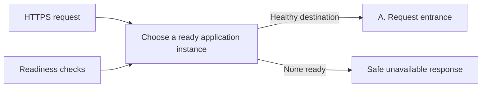
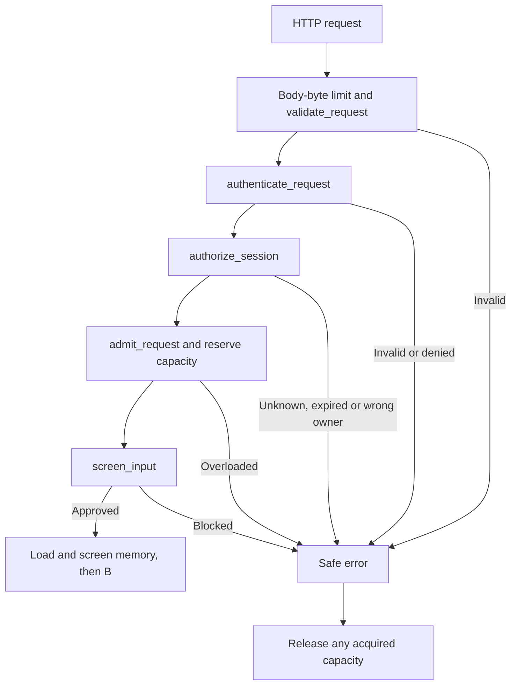
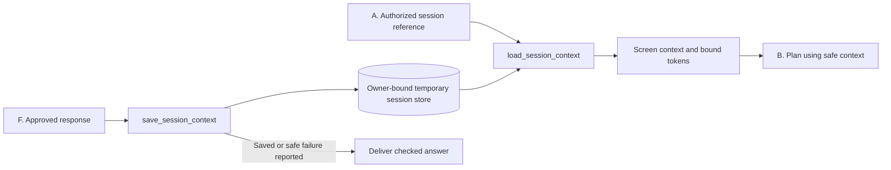
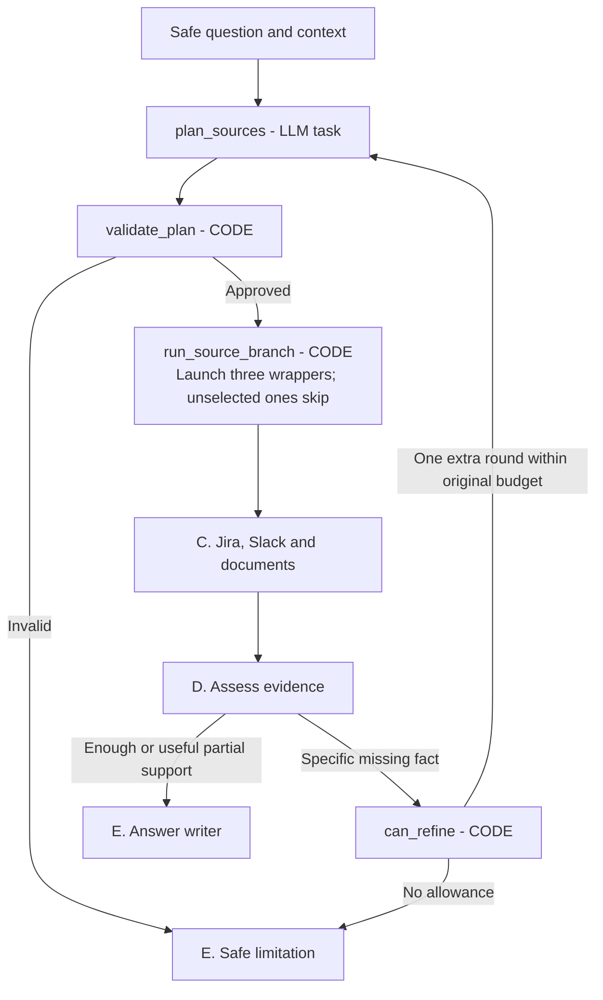
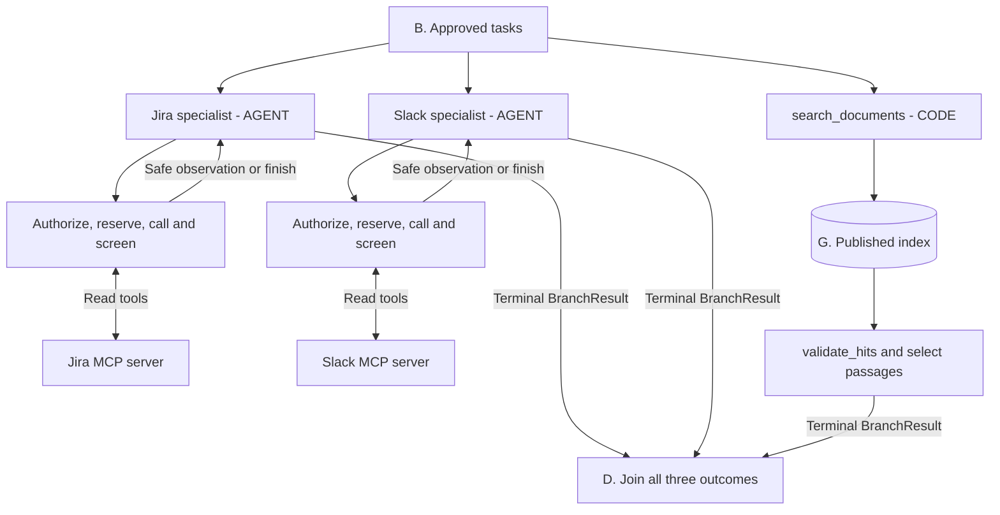
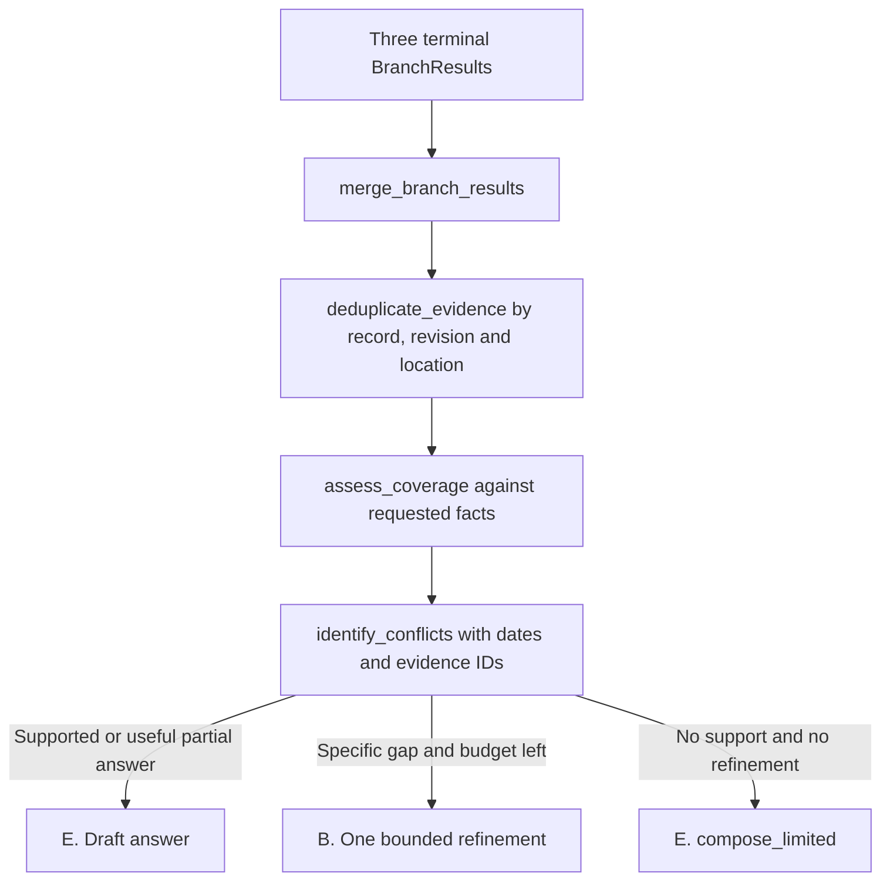
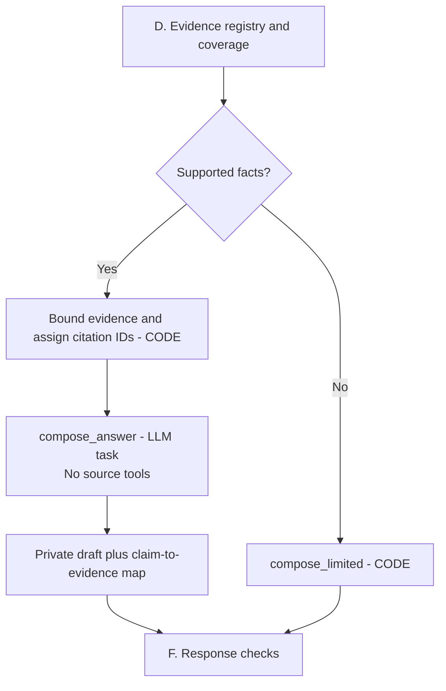
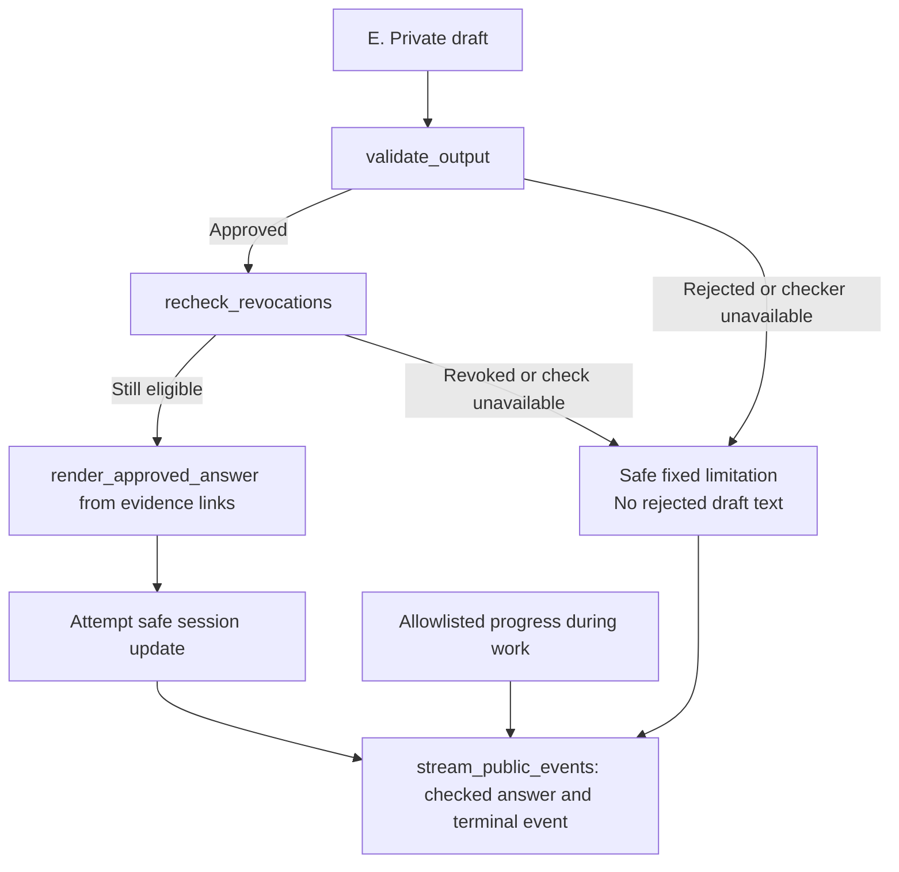
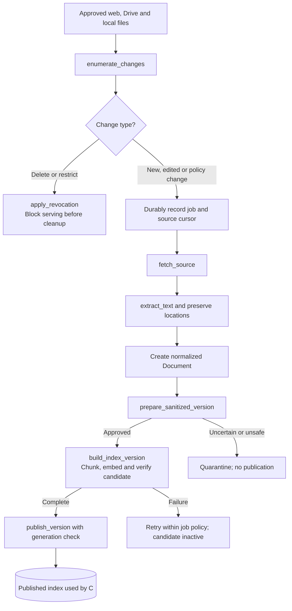

# Low-level design: inside each main part

Updated October 1, 2026. **Reading guide: existing code and proposed upgrade are different.**
The method walkthroughs describe the proposed upgrade unless explicitly labeled
**Current code**. The upgrade is not implemented by writing these documents.

## Read this first

This is an internal engineering assistant. An employee asks a question; the app
looks up source information and writes an answer with supporting links. The
existing application searches ingested Jira, Slack, DevPortal and City Map data.
The proposed version reads Jira and Slack live through MCP, and continues to
search a prepared index for documents. Document retrieval remains required.

There are **two connected workflows**:

1. **Before questions arrive:** G prepares approved documents for search. This
   background work creates passages and vectors, not answers to future questions.
2. **When a question arrives:** A–F retrieve relevant evidence and produce a
   checked answer. Session memory helps interpret follow-ups but is not evidence.

| Start here | What you will learn |
|---|---|
| This page, A–G | How the same HLD boxes work internally; each has a diagram and method walkthroughs |
| [Document ingestion LLD](ingestion-low-level-design.md) | Batch versus continuous ingestion, creating a Document, chunking, embeddings, vector-store choice and safe updates |
| [MCP integration LLD](mcp-low-level-design.md) | Host/client/server roles, connection lifecycle, four tools, schemas, client methods, server internals and failures |
| [LangGraph node reference](langgraph-nodes.md) | Exact agent/code distinction, branch joins, state updates and replay |

### Words used in the diagrams

| Word | Meaning in this project |
|---|---|
| Connector | Code that reads a source and converts it into our data format |
| Document | One normalized source record: title, body, source identity and link |
| Chunk / passage | A smaller piece of a document, kept with its source location |
| Embedding | A numeric representation of text used for similarity search |
| Vector store | Stores vectors with passage text/metadata and searches for nearby vectors |
| Evidence | Approved source text with identity, date and citation location; it is not a generated answer |
| Synthesis | A model writes an answer using selected evidence |
| LLM task | A bounded model call such as planning or drafting |
| Agent | A model/tool loop: choose a tool, observe its result, decide whether another call is needed |
| LangGraph | The framework executing nodes and transitions; it does not itself supply source facts |
| MCP | The protocol our application uses to discover and call source tools |

### Where the HLD connects to the LLD

The letters below are the same boxes in both HLD versions. Memory is shown
explicitly here to explain HLD 2; this does not select one HLD over the other.
These are logical components, initially modules in one query application plus
separate background ingestion workers, not seven required microservices.



This overview is the normal path. Each section below shows its failure decisions.
A failed memory save does not discard a checked answer. Guardrails are applied
at entry, source calls/results, ingestion, and release; they are not only box F.

### Follow one fake example all the way through

Question: **"Why is PAY-123 delayed, and where is its rollout guide?"**

| Step | Concrete transformation |
|---|---|
| G, earlier | A Markdown rollout guide becomes a Document, approved passages and vectors. No question is required to do this. |
| A + memory | Validate the employee/question/session; produce safe text and a request ID. A new session has empty context. |
| B | Plan the facts needed: delay reason and guide location; approve Jira, Slack and document tasks. |
| C, Jira | With an exact ID, the specialist can call `get_issue` directly. Fake PAY-123 says a release test is failing. |
| C, Slack | Search messages for PAY-123, then read a matching thread if needed. A fake older message says the release was ready. |
| C, documents | Embed the guide query and search the index G created; retrieve the guide section and its recorded link. |
| D | Retain the newer ticket and older conflicting thread with dates; mark the guide question supported. |
| E | Draft: release testing is blocking the ticket; the older thread reported readiness; link the guide. Attach evidence IDs to claims. |
| F + memory | Check the draft and current eligibility, resolve links from evidence, save bounded safe context and release the checked result. |

For **"Who owns it?"**, memory resolves *it* to PAY-123; C still reads fresh
ownership evidence. The previous answer is not reused as proof.

### Minimum data passed between components

These are proposed contracts; complete field rules are in the
[service reference](service-reference.md#1-shared-contracts).

| Contract | Important fields | Why the next component needs it |
|---|---|---|
| SafeRequest | request ID, trusted actor/session reference, safe question, deadline, policy version | Identify and limit work without putting credentials in prompts |
| SourceTask | round, source, needed facts, safe query or record ID, limits | Tell a reader exactly what to find |
| BranchResult | source, round, status, approved evidence, safe failure code | Distinguish an empty search from an unavailable source |
| Evidence | ID, record/revision, safe text/title/URL, location, updated/retrieved dates, eligibility/redaction versions | Trace each answer claim to a usable source |
| AnswerDraft | claims and evidence IDs in private temporary storage | Allow checking before public release |
| AnswerResult | checked text, citations, limitations, request ID | A deliberately small public response |

Do not silently reduce Evidence to text plus URL: the current `RetrievedChunk`
does not carry all the version/location fields the proposed policy checks need.
That contract must be extended during implementation.

This is the same system as the [HLD](high-level-design.md), with one box opened at
a time. Letters and names match exactly. Method names below are proposed teaching
names, not functions that already exist in the repository.

Each section explains **input -> functions -> output**, using the same fake question:

> Why is the Payments release delayed, and where is its rollout guide?

An **evidence item** is a piece of approved source information with its source,
link, location and date. It is not an answer generated by a model.

Each function row links to a walkthrough directly below its section. Every
walkthrough includes **input -> ordered steps -> example return -> failure path**.
The steps describe proposed behavior, not already implemented code. Pseudocode is
an explanation of the algorithm, not a full Python solution.

Start with [validate_request](#validate_request) for a simple example, then follow
A through G. You do not need to read all functions in one sitting.

## Load balancer before A



**Input:** an incoming HTTPS request from an employee.

**How we will implement it:** configure a reverse proxy or managed load balancer
with the addresses of our application instances. An instance is one running copy
of the API and its workflow. Health checks tell the balancer which instances can
accept new requests. It selects one healthy instance and forwards the request to A.
The specific product will be selected when we choose the deployment environment.

| Configuration | How it will work |
|---|---|
| Healthy destinations | Check a minimal readiness endpoint and stop sending new requests to an instance that fails readiness checks. Keep detailed diagnostics private. |
| HTTPS and network access | Accept encrypted client traffic; for production also protect the connection to the application. Restrict direct application access to trusted infrastructure. |
| Streaming | Configure the proxy to pass progress events without buffering and keep connection timeouts compatible with the application's request deadline. |
| Session access | Each instance validates the employee and loads owner-bound session state from shared storage when multiple instances are used. A request must not depend on one instance's private memory. |
| Shutdown and failures | Stop accepting new work before retiring an instance and allow bounded time for active work to finish. Do not blindly replay a streamed or already-started request on another instance. |

**Output:** the request reaches one healthy application instance. No healthy
instance means a temporary-unavailability response. The balancer cannot remove
Jira, Slack or model-provider quotas; application admission and tool limits remain
necessary. This is infrastructure configuration, not an LLM call or LangGraph node.

## A. Request entrance



Release capacity on success, timeout and cancellation too, using a `finally`
cleanup path around the whole request. The error arrows do not represent agents.

HLD job: receive an authorized, safe question.

**Input:** the employee's question and sign-in information.

| Proposed function | What it does in short | How it works, step by step |
|---|---|---|
| [authenticate_request()](#authenticate_request) | Checks who the employee is and whether they may use the assistant. | [Steps, example and failure path](#authenticate_request) |
| [authorize_session()](#authorize_session) | Makes sure any conversation being continued belongs to this employee. | [Steps, example and failure path](#authorize_session) |
| [validate_request()](#validate_request) | Rejects an empty, oversized or incorrectly formatted request. | [Steps, example and failure path](#validate_request) |
| [screen_input()](#screen_input) | Removes or blocks sensitive input before model processing. | [Steps, example and failure path](#screen_input) |
| [admit_request()](#admit_request) | Ensures the service has capacity for this request. | [Steps, example and failure path](#admit_request) |

**Output:** a safe question with trusted employee/session information and a request ID.
If a required check fails, return a safe error instead of starting the search.

For the example, the output question is still the Payments question, provided it
passes screening. Employee credentials are not sent to the language model.

For example, `validate_request()` will accept
`{"question": "Why is PAY-123 delayed?"}`. It will reject a number in place of the
question, a string containing only spaces, or text over the configured length.
FastAPI/Pydantic will validate a strict request model: trim surrounding whitespace,
require a string of at least three characters after trimming, enforce a proposed
8,000-character maximum, validate the optional session ID format, and reject
unexpected fields. Also bound total request-body bytes at the HTTP boundary;
a field-length check alone is too late for an oversized body. Final limits are
configurable and must be tested. Safe field errors return before model/tool work.

This function checks the request's shape. `authenticate_request()` checks identity,
`authorize_session()` checks ownership, and `screen_input()` checks sensitive
content. Keeping those jobs separate makes failures easier to understand and test.

**Kind:** ordinary code; content screening may use approved detectors.

The table is a method inventory, not a forced execution order. Apply HTTP body
limits and cheap request-shape checks early. Authenticate and authorize the
session, reserve capacity, then run costly content screening and model/source
work. Release the capacity reservation even if screening rejects the request.


### authenticate_request

**Purpose:** Checks who the employee is and whether they may use the assistant.

**Receives:** A sign-in token from the request header; trusted identity-provider configuration.

**Steps inside the method:**

1. Require the expected authorization header; a missing token stops authentication.
2. Use a standard token-verification library and the configured provider's trusted public keys to verify the signature. Do not accept a key URL or algorithm merely because the token requests it.
3. Check the token was issued by our provider, intended for our application, and is within its valid time window.
4. Read the verified employee identifier and check application-access policy. Build a small actor object; keep the token out of graph/model state.

**Example return:** For a valid token, return an actor such as employee-demo-7 with permission to ask questions.

**If it fails:** Missing/invalid tokens return a safe authentication error; a valid identity without application permission is denied. The local exercise uses a separate fake issuer enabled only in local mode.

### authorize_session

**Purpose:** Makes sure any conversation being continued belongs to this employee.

**Receives:** The authenticated actor and an optional conversation session ID.

**Steps inside the method:**

1. If no session ID was provided, create a new random ID and store its owner and expiry on the server.
2. If an ID was provided, look up its server-side session record.
3. Compare the stored owner with the authenticated actor and check expiry. Never use an employee ID claimed in the JSON body as proof of ownership.
4. Return an authorized session reference and its version; the separate memory loader reads and screens bounded context.

**Example return:** Employee-demo-7 receives an owner-checked session reference. A new session starts with an empty context when the loader runs.

**If it fails:** An unknown, expired or differently owned supplied ID returns a generic session error without revealing another employee's details.

### validate_request

**Purpose:** Rejects an empty, oversized or incorrectly formatted request.

**Receives:** The parsed request body, after a separate HTTP body-byte limit has been enforced.

**Steps inside the method:**

1. Require a JSON object with question and, optionally, session_id; reject unexpected fields.
2. Require question to be a string. Do not silently turn a number or a list into a question.
3. Trim surrounding whitespace, then check the cleaned length against configured minimum and maximum values.
4. Validate the optional session_id format, then return a normalized request object. FastAPI/Pydantic performs the schema validation; our rules specify the constraints.

**Example return:** Input {"question": "  Why is PAY-123 delayed?  "} becomes {"question": "Why is PAY-123 delayed?"}.

**If it fails:** Input {"question": 123} fails the type rule; {"question": "   "} fails after trimming. Return a safe field error without echoing rejected sensitive text.

**Pseudocode (teaching outline):**

```text
body = parse_size_limited_json()
require body is an object
require body has only allowed fields
require question is a string
clean_question = trim(question)
require minimum <= length(clean_question) <= maximum
require supplied session_id has valid format
return ValidatedRequest(clean_question, session_id)
```

### screen_input

**Purpose:** Removes or blocks sensitive input before model processing.

**Receives:** The validated question and any session context that may be sent to a model.

**Steps inside the method:**

1. Run configured secret detectors and approved personal-data detectors over all model-bound text, not just the latest question.
2. Collect detected spans, their categories and the policy action for each category.
3. Replace safely removable spans with placeholders; if removing them destroys the question's meaning, block instead. Any contextual classifier must run in an approved environment.
4. Recheck the transformed text and return only the safe version plus reason codes; raw content does not go into normal logs.

**Example return:** A synthetic key in "This request failed with key FAKE_SECRET_123" can become "This request failed with key [REDACTED_SECRET]" if our fixture detector/policy permits it.

**If it fails:** Unavailable mandatory screening, unresolved sensitive content or misleading redaction blocks processing. Detection is fallible and needs adversarial tests.

### admit_request

**Purpose:** Ensures the service has capacity for this request.

**Receives:** Actor ID, request ID, current time, and configured rate/concurrency limits.

**Steps inside the method:**

1. Use a shared counter store to check the employee's recent request count and the total number of admitted active requests.
2. In one atomic operation—an update other requests cannot interleave—check capacity and reserve a slot if allowed.
3. Create an expiring lease for the slot. Renew while active and release on completion/cancellation, so crashed workers do not hold capacity forever.
4. Carry the reservation ID with the request; do not count it twice on an internal retry.

**Example return:** If a test limit is two active requests and the actor already has two, the third request is not admitted.

**If it fails:** Return a safe overload response with retry guidance. Identity and cheap shape checks happen early; costly screening/model/tool work must be behind admission.


## Session memory between A and B, and after F

**Job:** interpret follow-ups safely. This is separate from the vector index,
the answer cache, and an MCP transport session. It is proposed; the current
`AgentState` has no conversation history or configured checkpointer.



| Proposed method | Input and how it works | Output / failure |
|---|---|---|
| `load_session_context()` | Recheck owner/expiry, read only a bounded number of turns and subject references, remove revoked dependencies, screen all model-bound content, then enforce a token limit. | Safe context and session version. For an ambiguous follow-up when loading fails, ask for the missing reference instead of guessing. |
| `save_session_context()` | Accept only F-approved text and references; recheck owner and current dependencies, write against the expected session version, trim context and apply configured expiration. | New version; on conflict serialize/reload rather than overwrite another turn. If saving fails, deliver the checked answer with a safe context-unavailable indication. |

Example entry: employee-demo-7's session refers to PAY-123 and guide-17. Another
employee cannot read that session even if its ID is known. TTL and size limits
are configuration decisions still to be selected. A shared store supports any
API replica; local process memory is only suitable for a single-process exercise.
LangGraph checkpoints, if enabled later, need the same owner binding, screening,
expiry and revocation rules; enabling a checkpointer alone does not implement them.

## B. Coordinator



HLD job: decide and control which work is needed.

**Input:** A's safe question and permitted source scope.

| Proposed function | What it does in short | How it works, step by step |
|---|---|---|
| [plan_sources()](#plan_sources) | Makes one model call to propose which sources and questions to search. | [Steps, example and failure path](#plan_sources) |
| [validate_plan()](#validate_plan) | Checks that the proposed searches are allowed and limited in number. | [Steps, example and failure path](#validate_plan) |
| [run_source_branch()](#run_source_branch) | Starts each selected source reader under the request's time/call limits. | [Steps, example and failure path](#run_source_branch) |
| [can_refine()](#can_refine) | Decides whether one additional focused search round is allowed. | [Steps, example and failure path](#can_refine) |

**Output:** approved tasks sent to C, such as "read the Payments ticket", "find
the delay discussion", and "find the rollout guide".

LangGraph runs the workflow, including the transition from planning to source
reading. If independent, the source readers can run together. A retry does not
reset the original limits.

**Kind:** a bounded model task for planning, plus ordinary code for enforcement.
The coordinator does not grant itself extra permissions.

### plan_sources

**Purpose:** Makes one model call to propose which sources and questions to search.

**Receives:** The screened question, bounded safe context and the fixed source descriptions.

**Steps inside the method:**

1. List what each source can answer: Jira for tickets, Slack for discussions, documents for guides.
2. Send those descriptions and the safe question to one approved model with a structured-output schema.
3. Ask for needed facts and focused tasks, not unrestricted code or new tools.
4. Parse the reply and hand the proposal to validate_plan; do not start searching yet.

**Example return:** For the Payments question, propose needed facts ["delay reason", "guide location"] with Jira, Slack and document tasks.

**If it fails:** Malformed output or a model timeout becomes a planning failure or safe limited response; it does not trigger unlimited retries.

### validate_plan

**Purpose:** Checks that the proposed searches are allowed and limited in number.

**Receives:** The proposed source tasks, trusted source scope and remaining request budget.

**Steps inside the method:**

1. Check the plan matches the expected schema and every source is in the fixed allowed set.
2. Enforce the configured number of queries, query lengths and result limits. Screen model-generated query text before it leaves the application.
3. Check each task is within the trusted allowed source scope; the model cannot enlarge that scope.
4. Allocate task IDs and branch allowances under the same request deadline and aggregate budget. Each dispatched attempt is later charged once.

**Example return:** A plan containing Jira plus documents becomes approved tasks; a proposed unknown source such as personal_email is rejected.

**If it fails:** A 100-query plan cannot start 100 searches. Return a named invalid-plan or budget outcome.

### run_source_branch

**Purpose:** Starts each selected source reader under the request's time/call limits.

**Receives:** One approved source task, its allowance and a cancellation/deadline context.

**Steps inside the method:**

1. If the source was not selected, return skipped without a model or tool call.
2. Start the appropriate reader: Jira agent, Slack agent or document-search function. LangGraph runs the source wrappers in parallel.
3. Before each model/tool attempt, check the shared ledger and original deadline; reserve capacity atomically.
4. Capture the safe evidence on success. Convert expected source failures into a terminal result; propagate request cancellation rather than swallowing it.

**Example return:** The Jira branch can return {source: "jira", status: "ok", evidence: [E1]}; a timed-out Slack branch returns its timeout status.

**If it fails:** Every branch must terminate or be cancelled so the join cannot wait forever. A provider call already dispatched may still incur cost.

### can_refine

**Purpose:** Decides whether one additional focused search round is allowed.

**Receives:** The missing facts, number of search rounds used, remaining budgets and deadline.

**Steps inside the method:**

1. Check that assessment identified a specific missing fact which another focused search could help.
2. Check the configured refinement allowance is unused; initially only one extra round is allowed.
3. Check time, model tokens and source-call capacity remain. Do not retry a policy-denied scope.
4. Return true only when all checks pass; reserve the next round in parent-owned state.

**Example return:** If the guide is missing and budget remains, allow one focused document search. If all needed facts are present, return false.

**If it fails:** No remaining time/calls means finish with supported information and a limitation; refinement never resets the budget.


## C. Source readers



Each wrapper also returns `skipped`, `empty`, `denied`, `timed_out`, `unavailable`
or a bounded-budget result as appropriate. Deadlines end loops; the join does
not wait indefinitely. An agent can finish without searching if its task already
contains an exact record ID suitable for a read.

Read the [MCP LLD](mcp-low-level-design.md) for the complete connection, discovery,
tool-call and server-processing flow, including all four initial tool contracts.
See the [document query path](ingestion-low-level-design.md#8-how-the-index-becomes-an-answer)
for how indexed chunks become evidence and an answer.

HLD job: collect approved information from selected sources.

**Input:** B's approved tasks. There are three readers inside this box.

| Reader | Internal steps | Kind |
|---|---|---|
| Jira specialist | Choose search/read tool -> check permission -> call MCP -> screen returned records -> decide whether another read is needed | Agent with a limited tool loop |
| Slack specialist | Choose message search/thread read -> check permission -> call MCP -> screen messages -> decide whether another read is needed | Agent with a limited tool loop |
| Document search | Search prepared index -> validate access/version -> select relevant passages | Ordinary code, using embedding/search models as configured |

| Proposed function | What it does in short | How it works, step by step |
|---|---|---|
| [authorize_tool_call()](#authorize_tool_call) | Checks a proposed tool and its arguments before it runs. | [Steps, example and failure path](#authorize_tool_call) |
| [invoke_read_tool()](#invoke_read_tool) | Calls an approved Jira or Slack tool through MCP. | [Steps, example and failure path](#invoke_read_tool) |
| [screen_tool_result()](#screen_tool_result) | Converts the private raw reply into safe, eligible evidence. | [Steps, example and failure path](#screen_tool_result) |
| [search_documents()](#search_documents) | Searches the index made by G. | [Steps, example and failure path](#search_documents) |
| [validate_hits()](#validate_hits) | Excludes restricted, removed or outdated index versions. | [Steps, example and failure path](#validate_hits) |

**Output:** a result from each selected source containing approved evidence or
an explicit status such as empty, unavailable or denied. An unselected reader
returns skipped without searching.

Example of an approved evidence item, simplified:

```text
Source: Jira
Record: PAY-123
Text: Release blocked while the failing release test is resolved.
Link: the validated link supplied for this ticket
Updated: the timestamp supplied by the source
```

Raw replies are screened inside the tool-call boundary before being passed back
to an agent, saved in LangGraph state, or logged. Only content eligible for all
employees is usable. A tool being able to read a record does not prove eligibility.

### authorize_tool_call

**Purpose:** Checks a proposed tool and its arguments before it runs.

**Receives:** A proposed tool name and arguments, plus trusted server/source policy and actor context.

**Steps inside the method:**

1. Find the tool in the approved server/tool mapping. Reject unknown tools even if the MCP server advertises them.
2. Validate argument types and sizes. Check record IDs, channel/project scope and network destinations where relevant.
3. Require the tool to be permitted for read operations under this policy. Inject trusted scope through adapter logic rather than trusting model arguments.
4. Require an available execution reservation and return a short-lived authorization bound to these exact arguments.

**Example return:** get_issue with issue_id PAY-123 in an allowed project can proceed; update_issue is denied.

**If it fails:** A discovered tool or model claim of urgency never overrides policy. Record a safe denial code without exposing credentials.

### invoke_read_tool

**Purpose:** Calls an approved Jira or Slack tool through MCP.

**Receives:** An authorized exact tool call and an execution reservation.

**Steps inside the method:**

1. Obtain the configured MCP connection and the correct credential context; credentials are not placed in the model prompt.
2. Call the SDK tool-invocation operation with the approved name and arguments. Mark the attempt as dispatched in the budget ledger.
3. Wait only within the request deadline and enforce response-size limits in the transport/adapter.
4. Pass the private raw result directly into screen_tool_result before returning node state. Retry only approved transient failures, with a new charged attempt.

**Example return:** A call to get_issue("PAY-123") receives a record from the local fake MCP server and returns only its screened evidence to the agent.

**If it fails:** Normalize rate-limit, authentication, timeout and tool errors separately. A credential failure is not an empty search.

**Pseudocode (teaching outline):**

```text
authorization = authorize_tool_call(proposal, trusted_context)
reservation = reserve_attempt(authorization)
raw_result = MCP_call_with_limits(authorization)
safe_result = screen_tool_result(raw_result)
return safe_result
# raw_result is never returned to graph state or ordinary tracing
```

### screen_tool_result

**Purpose:** Converts the private raw reply into safe, eligible evidence.

**Receives:** A private raw MCP reply and trusted source eligibility policy.

**Steps inside the method:**

1. Validate the reply's structure, record count, text lengths and required identifiers.
2. Resolve company-wide eligibility from approved scope metadata or trusted access information, not a statement inside the message text.
3. For eligible items, screen body, title, URL and other returned metadata. Remove or withhold unsafe parts according to policy.
4. Build Evidence objects containing safe text, stable record/revision IDs, dates and validated citation locations.

**Example return:** A permitted ticket with one synthetic secret can produce sanitized E1. A restricted ticket produces no usable evidence.

**If it fails:** Unknown eligibility or unsafe redaction withholds the item. Never explain a denied item's private title or contents in the public result.

### search_documents

**Purpose:** Searches the index made by G.

**Receives:** A safe search query, permitted document scope and a result limit.

**Steps inside the method:**

1. Turn the safe query into an embedding: numbers used to compare meaning.
2. Run vector similarity and keyword matching over permitted published candidates; keyword matching helps with exact strings such as PAY-123.
3. Combine rankings using a defined rule, rather than comparing unrelated raw scores, and apply bounded candidate limits.
4. Call validate_hits, then select relevant approved passages within the answer-context budget, with their source links.

**Example return:** A query for Payments rollout finds guide passages and their heading/page references from G's prepared index.

**If it fails:** No relevant approved passages returns empty. A failed index connection returns unavailable, not empty.

### validate_hits

**Purpose:** Excludes restricted, removed or outdated index versions.

**Receives:** Candidate document passages and the current document metadata/removal store.

**Steps inside the method:**

1. For each hit, resolve its stable document ID and candidate version.
2. Check current company-wide eligibility and whether a removal/restriction record blocks it.
3. Compare its version with the active published version and required processing-policy versions.
4. Keep only passing hits and preserve their source location; discard the others before model use.

**Example return:** If the index returns guide version 1 but metadata says version 2 is active, version 1 is dropped.

**If it fails:** If required policy metadata cannot be read, withhold affected hits rather than trusting an old index filter.


## D. Evidence checker



HLD job: decide what the collected information supports.

**Input:** C's safe evidence and source statuses.

| Proposed function | What it does in short | How it works, step by step |
|---|---|---|
| [merge_branch_results()](#merge_branch_results) | Waits for selected work to finish and combines its outcomes. | [Steps, example and failure path](#merge_branch_results) |
| [deduplicate_evidence()](#deduplicate_evidence) | Removes repeated copies of the same evidence. | [Steps, example and failure path](#deduplicate_evidence) |
| [assess_coverage()](#assess_coverage) | Checks which parts of the employee's question have support. | [Steps, example and failure path](#assess_coverage) |
| [identify_conflicts()](#identify_conflicts) | Preserves conflicting statements and their dates for explanation. | [Steps, example and failure path](#identify_conflicts) |

**Output:** evidence suitable for answering, supported facts, and explicit gaps.

For the Payments example, it checks whether the evidence supports both the reason
for the delay and the guide location. If the discussion is missing, that becomes
a limitation; it does not become a made-up reason. Newer relevant information is
shown first, while older conflicting information is explained with dates.

**Kind:** ordinary code, optionally assisted by a bounded model assessment.
Assessments can be wrong, so we evaluate them; they never override access decisions.

### merge_branch_results

**Purpose:** Waits for selected work to finish and combines its outcomes.

**Receives:** Terminal outcomes from the Jira, Slack and document wrappers for this search round.

**Steps inside the method:**

1. Wait at the graph's join for all three wrappers; unselected wrappers contribute skipped, and failed selected wrappers contribute a typed failure.
2. Collect outcomes keyed by round and source so one branch cannot overwrite another branch's result.
3. Combine approved evidence into a list and collect source limitations separately.
4. Preserve stable ordering for evaluation; identical replayed results do not create duplicates.

**Example return:** Jira ok + Slack timed_out + documents ok produces Jira/document evidence plus a Slack-unavailable limitation.

**If it fails:** If a wrapper never finishes, the deadline cancels it and records a terminal failure. Do not silently replace failure with an empty evidence list.

### deduplicate_evidence

**Purpose:** Removes repeated copies of the same evidence.

**Receives:** The merged list of approved evidence.

**Steps inside the method:**

1. Build a key from source, stable record ID, revision and passage location.
2. Maintain a map of keys already kept.
3. Keep the first copy for a repeated identical key; preserve distinct revisions and locations.
4. If identical keys contain conflicting content, flag inconsistent data instead of choosing silently.

**Example return:** Two searches both returning the same PAY-123 revision yield one evidence item. A different revision is retained for comparison.

**If it fails:** Missing identity/location needs an explicit fallback or rejection; do not merge unrelated passages just because their first words look alike.

### assess_coverage

**Purpose:** Checks which parts of the employee's question have support.

**Receives:** Needed facts from the plan and the deduplicated evidence.

**Steps inside the method:**

1. Make a checklist such as delay reason, ticket status and guide location.
2. For each fact, identify evidence that actually states it; optionally ask a bounded model for claim-to-evidence mappings.
3. Validate that every referenced evidence ID exists. Mark each fact supported, missing or uncertain; treat model judgments as fallible.
4. Return coverage and limitations for the next decision: write an answer, refine once, or return a limitation.

**Example return:** If E1 states status and E2 contains the guide but neither gives a reason, mark delay reason missing rather than inferring it from Blocked.

**If it fails:** A classifier timeout or ambiguous support cannot create a supported fact. The workflow uses the safe partial/limited path.

### identify_conflicts

**Purpose:** Preserves conflicting statements and their dates for explanation.

**Receives:** Evidence concerning the same subject, with source dates and revisions.

**Steps inside the method:**

1. Group statements about the same fact, such as PAY-123 release status.
2. Compare normalized values where structured; use bounded model assistance to identify opposing prose when needed.
3. Attach the supporting evidence IDs and original timestamps to each conflicting claim.
4. Present newest relevant information first and retain the older conflicting statement; label unknown dates explicitly.

**Example return:** A newer ticket saying Blocked and an older thread saying Ready become two dated statements, not an unexplained single status.

**If it fails:** Different subjects or time periods are not automatically contradictions. Ambiguous cases are labeled uncertain.


## E. Answer writer



**Synthesis happens here at question time, not during ingestion.** G preserves
source text; C finds relevant passages; E explains those passages in response to
the current question. Neither extraction nor embedding writes the final answer.
The current implementations are `synthesize_answer()` / `asynthesize_answer()`
in `src/agent/nodes.py`. Their citation-marker filtering is not a complete
claim-support check. Their source-priority rule must be reconciled with the
proposed newest-relevant-evidence-first rule.

HLD job: explain supported information.

**Input:** D's approved evidence, supported facts and limitations.

| Proposed function | What it does in short | How it works, step by step |
|---|---|---|
| [compose_answer()](#compose_answer) | Makes a bounded model call to write a draft with references to evidence. | [Steps, example and failure path](#compose_answer) |
| [compose_limited()](#compose_limited) | Produces a clear limitation message when there is no supported answer. | [Steps, example and failure path](#compose_limited) |

**Output:** a private draft, not yet visible to the employee.

The writer receives only approved evidence. It has no MCP tools and cannot invent
new source links. If no evidence exists, ordinary code can produce the limitation
message without a model call.

**Kind:** bounded model task for supported answers; ordinary code for fixed limitations.

### compose_answer

**Purpose:** Makes a bounded model call to write a draft with references to evidence.

**Receives:** The safe question, coverage checklist, approved evidence registry and limitations.

**Steps inside the method:**

1. Assign stable citation labels to the selected evidence and bound the total prompt size.
2. Provide the safe evidence and requested facts to the answer model, with explicit instructions to preserve limitations and date conflicts.
3. Request a draft with claims and supporting evidence IDs. The writer receives no search tools or credentials.
4. Store the draft only in private short-lived memory until F validates it.

**Example return:** A draft may say "The ticket is blocked [E1]. The rollout guide is available [E2]." Links are resolved later from E1/E2.

**If it fails:** Model failure yields a safe unavailable outcome. Unknown evidence IDs or unsupported claims must be rejected by output checks rather than displayed.

### compose_limited

**Purpose:** Produces a clear limitation message when there is no supported answer.

**Receives:** The source outcomes, coverage and safe reason codes.

**Steps inside the method:**

1. Distinguish successful empty searches from unavailable sources, policy blocks and budget exhaustion.
2. Select an approved fixed message template matching that situation.
3. Include only public-safe limitations; do not reveal restricted-record existence or internal errors.
4. If related information is shown, label it Related information and do not present it as support for the missing answer.

**Example return:** Empty successful searches: "I could not find supporting information." Source failure: "I could not check Jira right now."

**If it fails:** Do not turn a permissions error into a claim that no ticket exists. The message still passes response-release rules.


## F. Response checker



HLD job: release only a checked response.

**Input:** E's private draft and the evidence used to support it.

| Proposed function | What it does in short | How it works, step by step |
|---|---|---|
| [validate_output()](#validate_output) | Checks sensitive content, citation references and claim support. | [Steps, example and failure path](#validate_output) |
| [recheck_revocations()](#recheck_revocations) | Checks that supporting content has not been marked restricted or removed. | [Steps, example and failure path](#recheck_revocations) |
| [render_approved_answer()](#render_approved_answer) | Builds display text and source links from approved evidence. | [Steps, example and failure path](#render_approved_answer) |
| [stream_public_events()](#stream_public_events) | Sends safe progress and the approved response to the employee. | [Steps, example and failure path](#stream_public_events) |

**Output:** a checked answer and source links, or a safe explanation that an answer
could not be provided. Failed draft content is never included in that explanation.

The proposed delivery mode shows progress while working, then releases the answer
after whole-draft validation. It still needs agreement before changing existing
token-streaming behavior. Automated support checks reduce risk; they do not prove
every factual claim correct.

**Kind:** ordinary code with optional approved content/support assessment.

### validate_output

**Purpose:** Checks sensitive content, citation references and claim support.

**Receives:** The private answer draft and the approved evidence registry.

**Steps inside the method:**

1. Screen the draft for sensitive data and unsafe rendered content.
2. Extract its cited evidence IDs and ensure every one exists in the approved registry.
3. Check material factual claims have relevant support, using rules plus an evaluated bounded assessment where needed.
4. Return an explicit approved/rejected decision. Only approved draft text may be rendered.

**Example return:** A draft citing E99 when the registry contains only E1 and E2 is rejected before any answer bytes are sent.

**If it fails:** Failed mandatory screening or uncertain material support leads to a safe limitation response, not automatic approval. Semantic support checks are imperfect.

### recheck_revocations

**Purpose:** Checks that supporting content has not been marked restricted or removed.

**Receives:** Evidence dependencies for the checked answer and the current policy/removal records.

**Steps inside the method:**

1. Immediately before release, read the latest relevant eligibility and removal versions.
2. Compare them with the versions attached to the draft's evidence, including cached evidence.
3. If anything is now restricted or removed, invalidate the affected draft/cache dependency.
4. Return release permission only when all required checks pass.

**Example return:** If PAY-123 was marked restricted while the draft was being written, do not release that draft.

**If it fails:** Policy-store unavailability blocks the affected release. Checks cannot detect an upstream change not yet received; measure that detection lag.

### render_approved_answer

**Purpose:** Builds display text and source links from approved evidence.

**Receives:** An approved draft and its validated evidence-to-citation map.

**Steps inside the method:**

1. Replace evidence labels with display citation numbers.
2. Build each citation from the stored safe title, canonical link and page/section—not a URL invented in model text.
3. Escape text and allow only safe markup/link schemes supported by our renderer.
4. Return an AnswerResult containing the answer, citations and public-safe limitations.

**Example return:** E2 can render as citation [2] pointing to the recorded rollout-guide location.

**If it fails:** Missing citation metadata or a prohibited URL prevents that link from being rendered and triggers the defined safe fallback.

### stream_public_events

**Purpose:** Sends safe progress and the approved response to the employee.

**Receives:** Safe workflow progress events followed by an approved AnswerResult or safe failure.

**Steps inside the method:**

1. Start the response event stream and emit a fixed started status.
2. During work, map internal progress to an allowlisted public vocabulary such as searching or checking; omit raw graph state and arguments.
3. After output and revocation checks, serialize the approved answer and citations, then emit one terminal completion event.
4. On disconnect, request cancellation and release resources; after headers are sent, use a safe error event rather than changing the HTTP status.

**Example return:** The employee sees "Searching sources", then "Checking answer", then the approved answer. No unchecked draft token is sent.

**If it fails:** Transport failure may interrupt delivery; do not claim the employee received a completed answer. Internal exceptions become safe error codes and a request ID.


## G. Document preparation



This diagram is the proposed continuous incremental design. The current command
performs a finite connector scan, skips matching content hashes and batches
embeddings. It has no implemented durable queue or continuous change listener.
The [ingestion LLD](ingestion-low-level-design.md) walks through both paths,
the creation of a Document, per-format extraction, current chunking defaults,
embedding calls, FAISS/OpenSearch choice and safer version publication.

HLD job: keep approved documents searchable. This runs separately from questions.

**Input:** approved web links, Google Drive items, Markdown, PDF and Word files,
plus notifications or discoveries that content changed or was removed.

| Proposed function | What it does in short | How it works, step by step |
|---|---|---|
| [enumerate_changes()](#enumerate_changes) | Finds new, changed, removed or newly restricted items. | [Steps, example and failure path](#enumerate_changes) |
| [fetch_source()](#fetch_source) | Safely downloads or reads an approved item. | [Steps, example and failure path](#fetch_source) |
| [extract_text()](#extract_text) | Reads its text and remembers headings, page numbers or other locations. | [Steps, example and failure path](#extract_text) |
| [prepare_sanitized_version()](#prepare_sanitized_version) | Checks eligibility and removes sensitive content where safe. | [Steps, example and failure path](#prepare_sanitized_version) |
| [build_index_version()](#build_index_version) | Splits approved text into passages and prepares searchable representations. | [Steps, example and failure path](#build_index_version) |
| [publish_version()](#publish_version) | Makes a complete new version searchable without losing the old one during a failed update. | [Steps, example and failure path](#publish_version) |
| [apply_revocation()](#apply_revocation) | Stops removed/restricted content from being served and cleans up its copies. | [Steps, example and failure path](#apply_revocation) |

**Output:** an updated document index used by C, with source links and locations.
Failed or uncertain documents are withheld for inspection. Failed extraction is
not treated as proof that the original document was deleted.

**Kind:** ordinary worker code, with approved embedding and screening services.

### enumerate_changes

**Purpose:** Finds new, changed, removed or newly restricted items.

**Receives:** Configured source scopes, saved source cursors/revisions and current policy versions.

**Steps inside the method:**

1. Ask each connector for changes since its saved checkpoint, or perform a bounded complete listing when necessary.
2. Compare source revision/content hash and processing-policy versions with stored metadata.
3. Create durable jobs for new/changed items and explicit deletion/permission changes.
4. Advance a source cursor only after its work is durably recorded. Infer missing-item deletion only after successful complete enumeration of the same scope.

**Example return:** Guide revision 2 creates an update job; an unchanged guide with a changed permission policy still gets policy processing.

**If it fails:** A partial listing or a failed file parse is not deletion evidence. Keep source scope and completeness alongside progress.

### fetch_source

**Purpose:** Safely downloads or reads an approved item.

**Receives:** A job containing a trusted source identity/location and size/deadline policy.

**Steps inside the method:**

1. Resolve the record through its approved connector and obtain scoped credentials outside the model.
2. For URLs, check scheme, destination and each redirect; for local files, check the resolved path stays inside allowed roots.
3. Read the content incrementally with byte/time limits into restricted temporary storage.
4. Return the fetched content reference plus observed revision/type metadata for extraction.

**Example return:** A permitted PDF is fetched with its revision; a link redirected to a prohibited internal address is blocked.

**If it fails:** Stop oversized downloads and timed-out reads. No raw content is sent to normal logs; clean up restricted staging under its retention policy.

### extract_text

**Purpose:** Reads its text and remembers headings, page numbers or other locations.

**Receives:** The fetched content reference, verified format and resource limits.

**Steps inside the method:**

1. Check actual format against allowed parsers rather than trusting a filename alone; apply configured file-security checks.
2. Run the selected parser in a restricted worker with memory/time limits and no unnecessary network access.
3. Extract text together with page numbers, headings or source locations. For scanned PDFs, invoke OCR only when enabled.
4. Return text blocks and locations, or a typed extraction failure.

**Example return:** A PDF paragraph becomes a block with text plus location "page 4"; a Word heading is preserved as a section location.

**If it fails:** A corrupt PDF is quarantined/reported, not interpreted as an empty document or a deletion. Legacy formats require explicit support.

### prepare_sanitized_version

**Purpose:** Checks eligibility and removes sensitive content where safe.

**Receives:** Extracted text/locations and trusted source eligibility metadata.

**Steps inside the method:**

1. Verify the source is eligible for all employees before approving its content for indexing.
2. Screen each text block and metadata field; replace safe-to-remove sensitive spans while preserving locations.
3. Recheck the result for unresolved sensitive content or misleading meaning after redaction.
4. Assign a sanitized version carrying source revision, policy and redaction versions.

**Example return:** A safe guide paragraph proceeds to indexing; a restricted HR document is excluded even if personal names could be removed.

**If it fails:** Uncertain content is quarantined. Raw staging is not the searchable knowledge store and is removed according to policy.

### build_index_version

**Purpose:** Splits approved text into passages and prepares searchable representations.

**Receives:** A sanitized version plus chunking and embedding configuration.

**Steps inside the method:**

1. Split text along appropriate document boundaries with configured passage size/overlap and retained locations.
2. Create chunk IDs containing stable document ID, candidate version and position.
3. Embed approved chunk text in bounded batches and write candidate vector/keyword records without activating them.
4. Persist the candidate, verify expected chunk count and visibility, then report readiness to publication.

**Example return:** Guide v2 produces v2-specific chunks while v1 remains the active eligible version.

**If it fails:** Embedding or partial write failure leaves v2 inactive. Retry/reconciliation tracks candidate progress without pretending it was published.

### publish_version

**Purpose:** Makes a complete new version searchable without losing the old one during a failed update.

**Receives:** A complete durable candidate version and the expected current metadata generation.

**Steps inside the method:**

1. Verify candidate completeness/search visibility and recheck current source revision/eligibility.
2. Read the active-version record, for example v1.
3. Conditionally switch the pointer to v2 only if the expected generation is still current and no revocation/newer update won the race.
4. Durably record dependent-cache invalidation, then retire old records asynchronously. Retrieval validates all hits against active metadata.

**Example return:** If v2 is ready, future validated retrieval uses v2; if publication fails beforehand, eligible v1 remains usable.

**If it fails:** Conflicting/newer revisions make the candidate superseded. Cross-store failures are recovered by reconciliation; this is not one transaction across every store.

**Pseudocode (teaching outline):**

```text
require candidate is durable and complete
require source remains eligible and candidate is current
old_generation = read_active_generation()
activated = switch_if_generation_unchanged(old_generation, candidate)
if not activated:
    mark candidate superseded or retry after reconciliation
else:
    enqueue old-version cleanup and dependent-cache invalidation
```

### apply_revocation

**Purpose:** Stops removed/restricted content from being served and cleans up its copies.

**Receives:** A verified deletion/restriction change for a stable source record ID.

**Steps inside the method:**

1. Write an authoritative serving-block record first; include a version so older source events cannot undo it.
2. Retrieval and response-release checks consult this record and stop serving every affected version once the block is visible.
3. Schedule idempotent cleanup of indexed chunks, cached answers and other derivatives; track completion.
4. Ensure restore/replay reapplies current blocks before restored indexes serve traffic.

**Example return:** Revoking guide-17 blocks both v1 and v2 and any answer cache that depends on them.

**If it fails:** Cleanup failure is retried while the serving block remains. Backups expire or are purged under the agreed policy; revocation does not mean every backup byte vanished instantly.


## How these teaching names map to the repository

These are mappings for future implementation, not claims that every method exists.

| Same HLD/LLD part | Existing starting point | Proposed additions |
|---|---|---|
| A. Request entrance | `src/api/main.py` | Identity, request policy and admission |
| B. Coordinator | `src/agent/graph.py`, `src/agent/state.py` | `src/orchestration/` for the new bounded workflow |
| C. Source readers | `src/retrieval/`, `src/vectorstore/` | `src/agents/` and `src/integrations/mcp/` |
| D. Evidence checker | Retrieval helpers in `src/agent/nodes.py` | `src/evidence/` |
| E. Answer writer | Synthesis functions in `src/agent/nodes.py` | `src/answering/` |
| F. Response checker | Response handling in `src/api/main.py` | `src/policy/` and checked response delivery |
| G. Document preparation | `src/connectors/`, `src/ingestion/` | Safe extraction, durable jobs and version publication |

Policy helpers are shared by several parts; they do not belong only to F.
Detailed data fields, budgets, methods, failures and storage rules are in the
[service reference](service-reference.md). Exact LangGraph joins, state updates
and agent loops are in the [node reference](langgraph-nodes.md).

## Implementation references

FastAPI can validate request bodies through Pydantic models. Strict validation
helps reject wrong types rather than silently converting them; our trimming,
length, ownership and content rules must still be defined explicitly. See
[FastAPI request bodies](https://fastapi.tiangolo.com/tutorial/body/) and
[Pydantic strict mode](https://docs.pydantic.dev/latest/concepts/strict_mode/).
