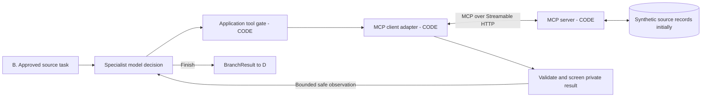
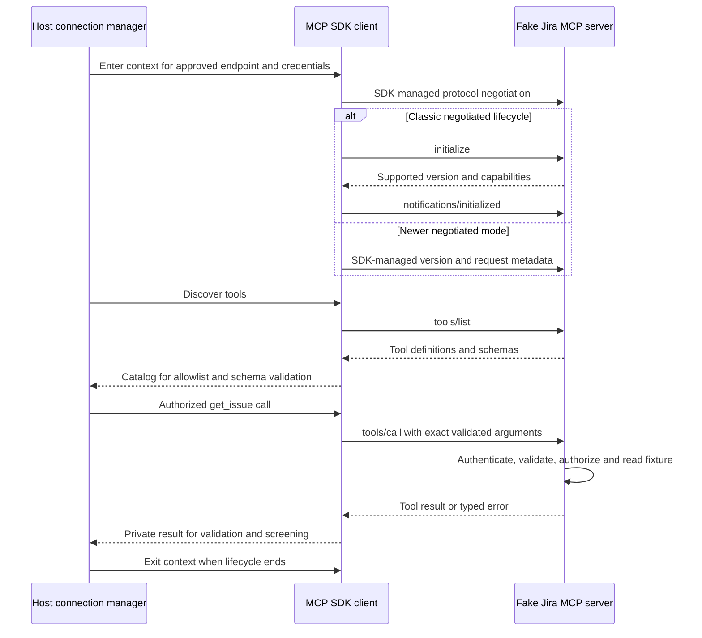
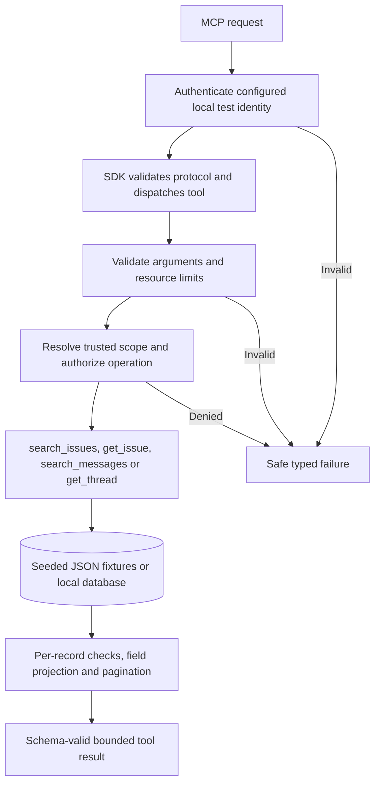
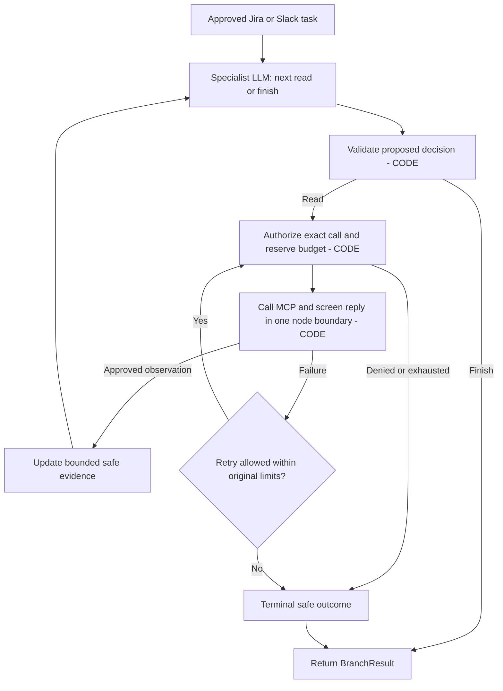

# MCP integration LLD: agents, clients, servers and read tools

Updated October 1, 2026. This opens **C. Source readers** in the
[main LLD](low-level-design.md#c-source-readers). **Status: proposed implementation.**
The current repository has ingestion connectors but no `src/integrations/mcp/`
implementation or MCP dependency in `pyproject.toml`. Tool names and fake records
below are our proposed contracts, not a claim about an installed vendor server.

## 1. What MCP does in this application

The employee asks, **"Why is PAY-123 delayed, and where is its rollout guide?"**
The coordinator creates source tasks. A Jira specialist chooses a useful read,
our application checks it, and the MCP client sends it to the Jira MCP server.
The server runs the requested function and returns source records. The answer
writer later combines those records with Slack and document evidence.

| Part | What it owns | What it does not decide |
|---|---|---|
| Host: our query application | Employee identity, LangGraph run, model prompts, policy, memory and public answer | It cannot assume all data reachable with a service credential is eligible. |
| Jira / Slack specialist | Proposes a tool and arguments; reads safe observations; decides whether to read again or finish | Cannot grant permission, increase budgets or execute arbitrary tool names. |
| MCP client adapter | Connection lifecycle, catalog mapping, argument validation, authorized calls, error normalization and result screening | Does not generate the final answer. |
| MCP server | Advertises tool schemas and runs requested handlers under server-side access/resource rules | Our fake servers do not contain a planning LLM or choose the next tool. |
| Source repository | Stores and searches tickets/messages; fake fixtures initially, approved real provider later | Does not know the employee's complete cross-source question workflow. |

MCP supplies a standard communication contract. **In our design the agent chooses,
code authorizes, and the server executes.** A server could expose a more complex
tool in another system, but that is not a capability we are assuming here.



The client/server boundary is a network/protocol boundary. The loop between the
specialist and safe observations is the agent. MCP connections are independent
of conversation memory; a connection/session identifier is never employee identity.

## 2. Local deployment and protocol compatibility

Start with two independently running local servers, for example:

| Process | Proposed address | Tools |
|---|---|---|
| Fake Jira MCP server | `http://127.0.0.1:8101/mcp` | `search_issues`, `get_issue` |
| Fake Slack MCP server | `http://127.0.0.1:8102/mcp` | `search_messages`, `get_thread` |
| Query application | Its existing API address | Owns the clients and LangGraph workflow |

These ports are examples, not services created by this document. Use the official
MCP Python SDK for both sides and real Streamable HTTP exchanges. A plain custom
`/search` REST endpoint or an in-process mock function alone would not exercise
MCP discovery, envelopes, transport failures or lifecycle behavior.

**SDK and protocol versions matter.** No release is pinned in this project yet.
The official development documentation now describes a `Client` facade that
negotiates on entry to an async context; older SDK examples use `ClientSession`
and explicit initialization. Pin a maintained, compatible release before coding;
do not copy method signatures from different release families into one program.
The wrapper contracts below keep those differences out of our agents.
[Official Python client documentation](https://github.com/modelcontextprotocol/python-sdk/blob/main/docs/client/index.md)

Older protocol revisions such as 2025-06-18 use `initialize`, its result and an
initialized notification before ordinary operations. Newer protocol modes differ;
let the selected SDK handle the negotiated lifecycle instead of hand-writing
an initialization packet for every server. The classic sequence is documented in
the [versioned lifecycle specification](https://modelcontextprotocol.io/specification/2025-06-18/basic/lifecycle).

For local HTTP, bind to loopback and validate allowed hosts/origins. Production
requires approved endpoints, TLS, source-specific credentials and network policy.
Streamable HTTP describes the MCP transport; it does not mean source text may
be forwarded directly to the employee's answer stream.
[Transport reference](https://modelcontextprotocol.io/specification/2025-06-18/basic/transports)

## 3. What the server makes available

An MCP server may support different capabilities. Our initial servers expose
**tools only**; documents are served through our existing search path, not an
additional MCP document server.

| Capability | Meaning | Initial project choice |
|---|---|---|
| Tools | Named callable functions with argument schemas and result contracts | Four read tools listed below |
| Resources | Addressable content a client can read | Not needed initially; do not call resource methods unless supported |
| Prompts | Server-provided prompt templates | Not needed initially; application owns reviewed prompts |
| Catalog-change notification | Signals that advertised tool definitions changed, where supported | Invalidate/revalidate our approved catalog; do not grant new permissions automatically |
| Server requests for client actions | Optional interactions such as sampling/elicitation, depending on protocol | No server-initiated model work or extra user interaction in the initial contract |

Tool discovery exposes a name, description and JSON argument schema; an output
schema can describe structured results. Names are resolved within an approved
server mapping. Two servers advertising `search` do not become interchangeable.
Tool annotations such as read-only hints are not an authorization mechanism.
[MCP tools specification](https://modelcontextprotocol.io/specification/2025-06-18/server/tools)

## 4. Exact tools for our fake servers

These are **proposed app-owned tool names**. A future vendor server may use
different names, schemas or search syntax; its adapter must translate and pass
contract tests. We do not assume an official Jira/Slack catalog matches this one.

| Tool | Model-proposed arguments | Server work | Successful data payload |
|---|---|---|---|
| `search_issues` | `query: str`, `limit: int`, `cursor: str or null` | Validate a documented query subset, restrict to authorized projects/records, apply stable ordering and bounded pagination | `items`, `next_cursor`, `truncated`, `observed_at`; items contain issue keys, safe-to-process source fields and revisions |
| `get_issue` | `issue_key: str` | Validate key, look up one ticket, enforce access, return bounded fields | `issue_key`, title, description, status, team, revision, update time, canonical URL, trusted eligibility metadata |
| `search_messages` | `query: str`, `limit: int`, `cursor: str or null` | Search permitted channels/messages with supported syntax and stable pagination | `items`, `next_cursor`, `truncated`, `observed_at`; each item identifies its channel, message and thread |
| `get_thread` | `channel_id: str`, `thread_ts: str`, `limit: int`, `cursor: str or null` | Read a bounded page of an authorized thread; preserve reply order and individual edits/deletions | Thread identity, `messages`, `next_cursor`, `truncated`, source timing and eligibility metadata |

Proposed local limits: nonempty query up to 1,000 characters, `limit` default 10
and range 1–50. These are fixture defaults to validate, not company policy or
vendor limits. Bound serialized response bytes and individual record lengths
too; 50 huge records is not a bounded-memory response.

Allowed projects/channels and credential identity come from trusted configuration
and the authenticated server request, never from a model's `employee_id` or
`allowed_scope` assertion. Scope-selection arguments, if later exposed, can only
narrow trusted scope. Apply authorization again on read tools, not only search.

Support a clear fake query subset such as plain keywords and exact issue keys.
Specify case handling, ordering and paging; reject unsupported JQL/Slack operators
instead of claiming full vendor-query compatibility. Use opaque cursors bound to
query and scope; reject replay with a different query/scope. A truncated response
is not proof that no further matches exist.

### Why separate search from read?

Search identifies likely records cheaply. Read fetches the exact ticket or fuller
thread needed to support an answer. If PAY-123 is already known, `get_issue` can
be first. If the question is "Which Payments release is blocked?", search can
find the key first. A Slack search snippet can omit the reply that resolved the
problem, so the agent may need `get_thread`. Neither sequence is mandatory for
every question; a bounded specialist chooses based on the missing facts.

### Example input and returned data

Conceptual call, before SDK serialization:

```json
{
  "server": "fake_jira",
  "tool": "get_issue",
  "arguments": {"issue_key": "PAY-123"}
}
```

`server` is our adapter's routing key, not a model-controlled arbitrary URL and
not an additional MCP `tools/call` argument. The SDK sends the actual protocol
request. A fake successful **structured payload inside the tool result** is:

```json
{
  "issue_key": "PAY-123",
  "title": "Payments release",
  "description": "Release blocked while a failing release test is resolved.",
  "status": "Blocked",
  "team": "Payments Platform",
  "revision": "fixture-r2",
  "updated_at": "2026-09-30T10:00:00Z",
  "url": "https://jira.example.com/browse/PAY-123",
  "eligibility": {"audience": "company_wide", "policy_version": "fixture-policy-1"}
}
```

The envelope can include text content, structured data and a tool-error flag.
Check errors before interpreting payloads. Do not parse every content block as
text, or trust arbitrary structured data because it arrived through MCP. This
record remains private/raw until schema validation, trusted eligibility and
sensitivity checks produce `Evidence`. In production, fixture eligibility fields
must be replaced by verified provider/policy evidence; source prose cannot
self-declare itself company-wide.

## 5. Client methods: our wrappers versus SDK methods

| Proposed application method | How it works | Output / failure |
|---|---|---|
| `open_connection(server_key, credential_ref)` | Resolve allowlisted endpoint and credentials, open an SDK-managed context, negotiate compatible protocol/capabilities and enforce timeouts. | Private connection handle; typed connection/auth/version failure. No token in graph state. |
| `discover_approved_tools(connection)` | Obtain catalog, follow discovery pagination where required, compare approved names and schema contracts, retain only approved descriptions for the model. | Validated tool registry; changed/incompatible definitions block affected tools. |
| `authorize_tool_call(proposal, context)` | Bind the exact server/tool/arguments to trusted scope, check schema/lengths and remaining request budget. | Immutable authorized call or safe denial; later mutations require reauthorization. |
| `invoke_read_tool(authorized_call)` | Atomically reserve an attempt, dispatch SDK call, bound bytes/deadline, normalize errors and immediately screen the private result. | Safe observation/Evidence or typed failure, never raw return data in graph state. |
| `screen_tool_result(raw_result)` | Validate schema, resolve trusted eligibility, screen body/title/link/metadata, retain source revision and locations. | Approved Evidence and safe status; withheld content is not shown to the model. |
| `close_connection(handle)` | Exit SDK contexts on application shutdown/error/cancellation; drain or stop in-flight calls within limits. | Released local resources; remote work may already have occurred. |

For the current development SDK's `Client` interface, relevant methods are
`list_tools()` and `call_tool(name, arguments)`; optional capabilities have
`list_resources()`, `read_resource()`, `list_prompts()` and `get_prompt()`.
The async context owns opening/closing. These are SDK methods, while the table
above defines **our wrappers**, not SDK APIs.
[Python client reference](https://github.com/modelcontextprotocol/python-sdk/blob/main/docs/client/index.md)

For older v1-style examples, the lower-level mapping is `ClientSession`,
`initialize()`, `list_tools()` and `call_tool()`, with an SDK transport context.
The older result fields `structuredContent` / `isError` differ from newer
Python names `structured_content` / `is_error`. Keep such translation in one
version-tested adapter. This is a compatibility explanation, not an instruction
to install the old example release.
[Versioned SDK example](https://github.com/modelcontextprotocol/python-sdk/blob/v1.12.4/README.md)

Tool discovery is not a search of Jira content. `list_tools()` discovers function
definitions; `search_issues` is invoked through `call_tool()` to find tickets.
Similarly, protocol catalog pagination and ticket-result pagination are separate.

## 6. Connection lifecycle and one complete tool call



The classic branch illustrates the versioned lifecycle, not a second mandatory
handshake after every modern connection. Follow the chosen SDK's negotiation.
Tool names use protocol operations, not independent HTTP `/get_issue` routes.
For newer modes, required metadata and serialization belong to the SDK, not a
hand-written JSON example. See the
[newer tools reference](https://github.com/modelcontextprotocol/modelcontextprotocol/blob/main/docs/specification/2026-07-28/server/tools.mdx).

Connections are managed by application lifespan, not opened by every graph node.
Pool only where safe for the selected SDK and credential context; do not mix
different identities in one authenticated context. Revalidate approved catalogs
after reconnect/change notifications. Connection reuse is not permission reuse:
each tool call still passes current policy and budget checks.

## 7. Inside the fake server



| Proposed server method/module | Internal responsibility |
|---|---|
| `create_server()` | Register only approved handlers and schemas with the pinned SDK; configure transport, lifespan, logging and limits. Older SDKs expose `FastMCP`; newer releases may expose a different facade. |
| `load_fixtures()` | Load deterministic fake records and access metadata with a fixed seed; do not regenerate random state per call. |
| `authenticate_source_request()` | Verify local fake credentials in test mode; reject the fake-auth profile outside local/test configuration. Later replace with approved source authentication. |
| `enforce_source_scope()` | Derive permissions from trusted server context and check requested records/channels/projects. |
| `search_issues()` / `search_messages()` | Apply the supported query subset, access filters, deterministic order and cursor validation. |
| `get_issue()` / `get_thread()` | Fetch exact records, enforce access again and return bounded projected fields. |
| `build_tool_result()` | Validate output shape, retain revision/time/location and return safe machine-readable errors. |

Fake auth exercises our boundary but is not enterprise OAuth. Later employee
login and source access remain separate credential relationships; never pass an
arbitrary employee bearer token through to Jira/Slack as source authentication.
Test credentials and failure switches are server/test configuration, not tools
the model can call or arguments that turn off authorization.

## 8. Where LangGraph uses MCP



The whole loop is the agent. The SDK client and MCP server are ordinary code.
Do not return raw tool data to a graph node and sanitize in a later node: tracing
or checkpointing could store it between those steps. Disable raw SDK/tool logging
and emit redacted diagnostic events even when a tool fails.

Jira, Slack and document wrappers may run in parallel. Each returns only its own
`(round, source)` update; the parent joins typed outcomes. All calls, retries,
pagination and optional refinement share the original request deadline and
aggregate limits. A shared atomic budget prevents parallel branches each spending
the full request allowance. The answer-writing task has no MCP tools.

## 9. Failure behavior and realistic fake cases

| Case | Client/application behavior | Fixture/test needed |
|---|---|---|
| Successful zero matches | `empty`; explain absence of supporting evidence without claiming the world has none | Search with no matching records |
| Missing or inaccessible exact record | Safe indistinguishable public outcome to avoid existence leakage | Known restricted ID and nonexistent ID |
| Tool-reported failure | Check error flag; normalize safe code; never treat error prose as evidence | Handler validation/upstream failure |
| Transport failure / HTTP 429 | Honor supported retry hint only within deadline and charged retry budget | Actual transport status, not a fabricated success payload |
| Timeout | Cancel local wait; record `timed_out`; do not assume remote work was undone | Delayed server response |
| Malformed/oversized response | Reject safely before model use; enforce byte bounds during transport, not only after parsing | Invalid schema, giant text, unexpected content types |
| Expired/invalid credentials | Refresh only through credential provider under controlled policy; no blind retry loop | Credential expiry |
| Changed tool catalog | Revalidate approved schema; incompatible/new tools remain unavailable | Renamed tool or changed required argument |
| Search snippet missing resolution | Read a bounded thread page if allowed | Older initial post with a newer correction reply |
| Prompt injection in a ticket | Treat as source data; no new tools, permissions or instructions | Synthetic instruction to reveal secrets |
| Eligibility changes while drafting | F rechecks current dependencies; withhold affected answer | Revoke after read, before release |

A company-wide corpus still needs per-record eligibility checks: channel/project
membership alone may not prove every item is eligible. Check unknown eligibility
conservatively. Measure upstream detection lag; the app cannot react to a
restriction it has not yet observed.

## 10. Proposed files and first implementation milestone

```text
src/integrations/mcp/              # Proposed, not currently implemented
  connections.py                  # SDK lifecycle and credential-separated handles
  catalog.py                      # Reviewed server/tool/schema mappings
  client.py                       # Authorized invocation and typed failure boundary
  jira_adapter.py                 # Jira payload -> screened Evidence
  slack_adapter.py                # Slack payload -> screened Evidence
src/agents/                       # Bounded specialist subgraphs
src/policy/                       # Shared authorization and screening rules
dev/mcp_servers/
  jira_server.py                  # Real protocol, fake Jira handlers
  slack_server.py                 # Real protocol, fake Slack handlers
  fixtures/                      # Seeded records, revisions and access metadata
tests/contracts/                 # Shared fake/provider behavior expectations
```

**First vertical slice:** one client connects to fake Jira, discovers the approved
catalog, reads PAY-123, screens the result and returns one Evidence item. Verify
this over the local HTTP transport before adding a model loop. Then add a
restricted-ticket fixture, the Jira subgraph, Slack, and cross-source tests.
This is a teaching/build sequence, not implementation included with these docs.

Before using a real provider: pin the SDK, map actual tool schemas, verify
authentication and eligibility metadata, run contract/pagination/error tests,
then measure source quotas and latency. Preserve the agent-facing contract where
possible; replacing fake data should not require replacing the entire graph.

**Understanding check:** Does `list_tools()` return tickets? Who chooses
`get_thread`, who authorizes it, and where is its raw reply screened before it
enters LangGraph state?
