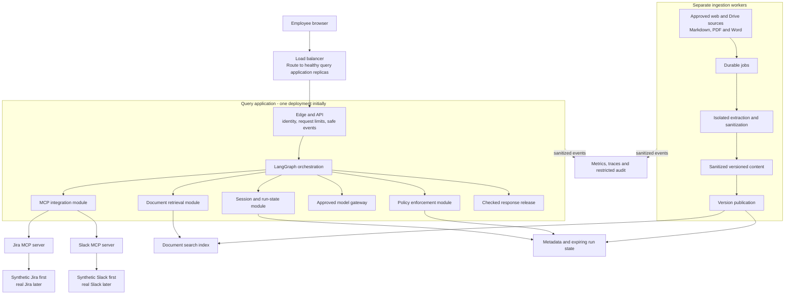

# Production architecture reference

Start with the [introductory design](high-level-design.md). This page preserves the full
engineering reference for later use.


Status: proposed; see [decisions](README.md) and [verified gaps](gap-register.md).

## 1. Responsibility and trust boundaries

The service answers internal engineering knowledge questions. It does not execute
financial transactions, modify tickets, or post messages. The employee identity
must be authorized to use the application; retrieved content must independently
be eligible for all employees. A broad source credential is not eligibility proof.



Raw source content is untrusted. It is handled in restricted adapter/extraction
memory, screened, and then converted to approved evidence. Raw tool replies must
not automatically enter agent messages, checkpoints, model calls, or traces.
The model gateway performs a final data-policy check on every model-bound payload.

Credentials remain in credential providers, never prompts or graph state. MCP
servers and tool schemas come from an approved registry; a model cannot register
new servers, expand scopes, or select an arbitrary network destination.

## 2. Logical services and deployment

| Logical service | Responsibility | Initial placement | Scale boundary |
|---|---|---|---|
| API and identity | Sign-in, session ownership, limits, SSE response contract | Query process | Multiple API replicas behind load balancer |
| Orchestration | Validated planning, agent scheduling, budgets, terminal outcomes | Query process with LangGraph | Query replicas; shared budgets/state where needed |
| Policy | Eligibility, data screening, tool authorization, release decisions | Shared module in query and workers | Versioned policy and shared revocation state |
| MCP integration | Client lifecycle, approved tools, credentials, source quotas | Query process; local fake servers separate | Shared provider quotas across replicas |
| Document retrieval | Eligible hybrid search, metadata and citation resolution | Query process | Independent search capacity |
| Ingestion | Source changes, safe parsing, sanitization, version publication | Worker process | Queue-driven workers with bounded concurrency |
| Model gateway | Approved model selection, budgets, timeouts, safe telemetry | Query/worker module | Shared provider limits; approved fallbacks only |
| Session/cache/state | Expiring session state, run recovery, revocations, cache versions | Local adapters for learning | Durable metadata plus shared ephemeral store |
| Operations/evaluation | Quality tests, audit, metrics, deployment and recovery | Test runner and observability tools | Independent retention and access policies |

These are responsibility boundaries, not a requirement for nine microservices.
Do not add service-to-service network calls until isolation or measured load warrants them.

## 3. Stored information

| Store | Contents | Important rule |
|---|---|---|
| Sanitized content store | Approved text versions and citation locations | Never treat extracted text as eligible by default |
| Metadata database | Source IDs, revisions, eligibility, publication state, tombstones, jobs | Authoritative record of what may be served |
| Search index | Sanitized chunks, vectors, keyword fields, version metadata | Derived data; post-check every returned version before use |
| Session/checkpoint store | Bounded sanitized context and run progress | Owner-bound, encrypted, expiring; saved chat history remains off |
| Cache | Approved answers/evidence with dependency versions | Recheck revocations; TTL alone is insufficient |
| Audit store | Actor reference, policy/tool decisions, evidence IDs, timestamps | Restricted and tamper-resistant; no routine raw content |

No database/cloud vendor is finalized. Local adapters must preserve these contracts.
Production secrets need managed storage and rotation. Transport and persistent
stores need encryption and explicitly scoped service identities.

## 4. Quality and answer semantics

Return distinct outcomes: answered, partial, insufficient evidence, blocked,
temporarily unavailable, cancelled. Empty search is different from failed search.
Related material must be labeled as related and cannot support an absent answer.

Preserve source revision, updated time, retrieval time, and original location.
Newest relevant evidence is presented first, with older conflicts explained.
Retrieval time is not update time, and newness alone is not correctness. Slack
and Jira calls do not create a shared point-in-time snapshot; describe that limit
when source timing materially affects the answer.

Citation validation checks IDs and links against retrieved evidence. Assessing
whether evidence supports a claim is an additional, fallible quality check.
Unknown support triggers omission, qualification, or refusal, not fabricated certainty.

## 5. Availability, performance and scale

Keep the handoff's 99.9% monthly availability and five-second complete-answer goal
as provisional targets. The latency percentile, offered load, source health conditions,
maximum request duration, and freshness objectives still need agreement.

For capacity planning:

```text
1 million requests/day   = about 11.6 requests/second on average
1 million requests/30 days = about 0.386 requests/second on average
provider calls/second = arrival rate * cache-miss fraction * average calls/request
concurrent requests is approximately arrival rate * average duration
```

Measure peaks, response length, tool fan-out and provider quotas. More API replicas
do not increase a shared source quota. Enforce per-user admission, global provider
limits, bounded queues, timeouts, and cancellation. Do not keep accepted work waiting
indefinitely or retry overload into more overload.

Separate ingestion from interactive search so a large PDF import cannot starve
questions. Scale workers by queue age and replicas by latency/in-flight work as
well as CPU. Cache only when eligibility and freshness can be revalidated; do not
claim cached ticket status is live. Begin with semantic answer caching off on the new path.

An optional source failure can produce a labeled partial answer. Unavailable
authorization or revocation checks fail closed. If a required source is unavailable,
say that it could not be checked. Preserve the last eligible index during ingestion
failure; security revocations override that fallback.

Recovery includes identity configuration, metadata, policy/tombstones, index,
credentials, and source checkpoints. Test restoration and replay with deletions
reapplied before serving traffic. Handoff RTO/RPO values are targets, not demonstrated results.

## 6. Production release gates

- Source/model processing approved by the actual organization; classification and retention configured.
- Authentication, company-wide eligibility and tool restrictions exercised through bypass attempts.
- Golden questions evaluate correct facts, citations, abstention and cross-source conflicts.
- Adversarial files/tool results cannot cause forbidden calls or unchecked output release.
- Contract tests cover real MCP initialization, discovery, calls and failures with fake data.
- Load tests include realistic downstream quotas and delays; report latency percentiles and errors.
- Crash/replay tests prove version publication and deletion safety; restore drill validates recovery.
- Dependencies pinned for releases, images scanned, non-root containers, TLS and secrets configured.
- Staged deployment, rollback, on-call ownership, alerts and per-source/model kill switches exist.

None of these gates is satisfied merely by writing this design.
