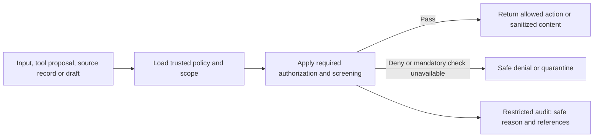
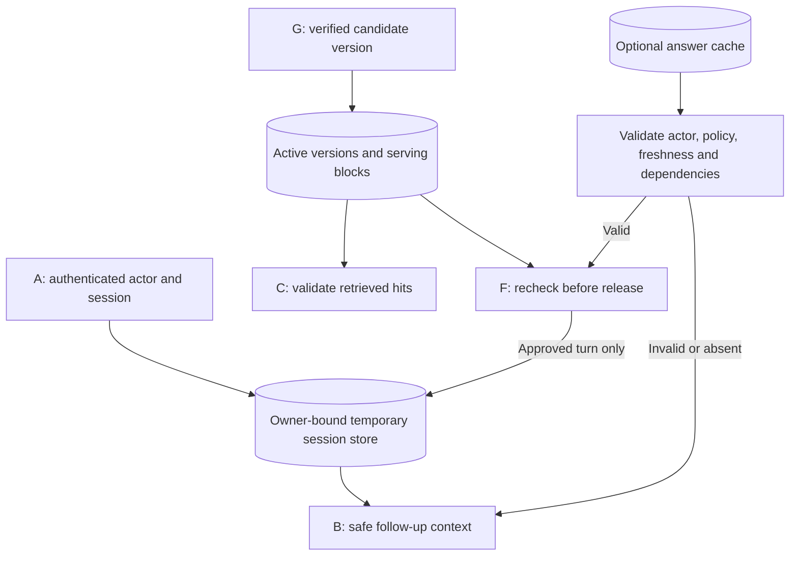
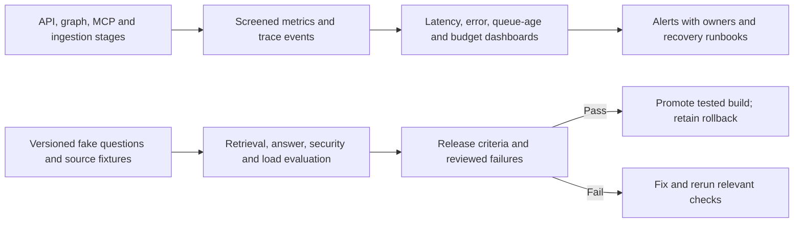

# Detailed service contracts reference

Updated reading links, October 1, 2026. Start with the
[main LLD](low-level-design.md#read-this-first) for vocabulary and one worked
question. This reference retains the detailed contracts; use these diagrams
to locate each service in that same flow:

| Service in this reference | Diagram / walkthrough |
|---|---|
| API and identity | [A. Request entrance](low-level-design.md#a-request-entrance) |
| Orchestration | [B. Coordinator](low-level-design.md#b-coordinator) and [LangGraph nodes](langgraph-nodes.md) |
| Policy and guardrails | A for input, C for tool/results, G for ingestion and F for release; shared policy flow below |
| MCP integration / fake sources | [MCP LLD](mcp-low-level-design.md) |
| Document retrieval | [C. Source readers](low-level-design.md#c-source-readers) and [index-to-answer sequence](ingestion-low-level-design.md#8-how-the-index-becomes-an-answer) |
| Ingestion and publication | [G. Document preparation](low-level-design.md#g-document-preparation) and [ingestion LLD](ingestion-low-level-design.md) |
| Model and answer | [D](low-level-design.md#d-evidence-checker), [E](low-level-design.md#e-answer-writer) and [F](low-level-design.md#f-response-checker) |
| Session, cache and metadata | [Memory LLD](low-level-design.md#session-memory-between-a-and-b-and-after-f) and supporting storage flow below |
| Operations, audit and evaluation | Supporting operations flow below |

### Shared policy flow



### Supporting storage flow



Session memory, answer cache and document metadata are separate responsibilities,
even if a pilot stores them in one database. Start the new MCP path without
answer-cache reuse; add it only after dependency invalidation is tested.

### Supporting operations flow



These are proposed support flows, not extra tool-choosing agents. Ordinary
telemetry failure should not expose raw content or stop otherwise safe requests;
mandatory access/screening checks have stricter failure behavior.

Start with the [introductory design](low-level-design.md). This page preserves the full
engineering reference for later use.


Status: proposed contracts and method names, not runnable implementation.
Read the [HLD](high-level-design.md), [node guide](langgraph-nodes.md), and
[gap IDs](gap-register.md) together. Logical services initially share modules
where practical; separate deployments are specified only where useful.

## 1. Shared contracts

| Contract | Required fields | Invariant |
|---|---|---|
| `RequestContext` | request_id, actor_ref, session_ref, policy_version, deadline_at | Created by trusted API code, not accepted as model/user assertions |
| `SearchTask` | task_id, source, safe_query or record_id, needed_facts, result_limit | Schema validated; source and scope within policy |
| `SearchPlan` | tasks, required_sources, freshness_requirement | Bounded task count; rationale is a short safe summary, not hidden reasoning |
| `Evidence` | evidence_id, source, record_id, revision, safe_text, safe_title, canonical_url, location, source_updated_at, retrieved_at, eligibility_version, redaction_version | Only approved sanitized content; missing source dates explicitly null |
| `BranchResult` | branch_id, source, status, evidence, safe_error_code, observed_at, calls_used | One terminal envelope per branch/round; no raw reply |
| `PolicyDecision` | allow/redact/deny/quarantine, reason_code, policy_version | Missing proof never defaults to allow |
| `AnswerDraft` | text, claims with supporting evidence_ids, limitations | Private unapproved object; never an SSE payload |
| `AnswerResult` | request_id, outcome, answer, citations, source_status, as_of, policy_version | Only released after checks; links copied from evidence registry |
| `SourceChange` | source_scope, source_id, revision, event_id, kind, observed_at | Delete/permission events processed even without text changes |
| `IngestionJob` | job_id, idempotency_key, stage, attempts, lease_until, revision | Durable progress and bounded retries; terminal failures visible |

Branch statuses: `ok`, `empty`, `skipped`, `denied`, `unavailable`, `timed_out`,
`budget_exhausted`, `invalid_response`. Public answers use `answered`, `partial`,
`insufficient_evidence`, `blocked`, `unavailable`, or `cancelled`.
Internal reasons must not disclose the existence or titles of restricted records.

Evidence identifiers distinguish revisions and locations. Eligibility and deletion
records use stable source identity so revocations apply to every derivative/version.
Source search scores are not assumed comparable across Jira, Slack and document
search. Rank normalized evidence using relevance/coverage and provenance, not a
raw cross-provider score sort.

## 2. API and identity service — G01, G02, G06, G14, G16

Placement: evolve `src/api/`; preserve the existing user edit in `main.py`.

| Method | Short purpose |
|---|---|
| `authenticate_request()` | Validate issuer, audience, expiry and application access; return trusted actor context |
| `authorize_session()` | Verify the session belongs to this actor before loading or resuming it |
| `validate_request()` | Enforce maximum question/body size and supported input schema |
| `admit_request()` | Reserve user/global capacity or reject overload early |
| `start_run()` | Create a run with policy version, deadline and cancellation handle |
| `stream_public_events()` | Emit only explicitly approved progress/result/error schemas |
| `cancel_run()` | Propagate disconnect/cancellation to active work and release unused reservations |
| `check_readiness()` | Report current required dependency readiness rather than startup index counts |

Preserve `/ask` and `/ask/stream` through response adapters where compatible;
introduce versioned response contracts before any breaking API change. Proposed
request body: question plus optional session_id. The actor is derived from auth.
Admin cache controls require separate authorization; liveness is minimal, detailed
dependency diagnostics are restricted.

HTTP errors before streaming: 401/403 for auth, 422 for invalid input, 429 for
admission limits, 503 for required dependency unavailability. After headers,
use safe terminal SSE errors with request ID. Never send `str(exc)`.

Disconnect cancellation is best effort for calls already accepted by a provider;
their charges remain accounted for. Exactly one terminal public result per live
stream; request IDs enable diagnostic correlation without exposing raw content.

## 3. Orchestration service — G02, G08, G14, G15

Placement: `src/orchestration/`; gradually adapt existing `src/agent/` entrypoints.

| Method | Short purpose |
|---|---|
| `build_query_graph()` | Register code nodes, LLM tasks, specialist subgraphs and explicit terminal routes |
| `plan_sources()` | Ask the model for bounded source tasks in a typed schema |
| `validate_plan()` | Enforce allowed sources and limits independently of model output |
| `run_source_branch()` | Run one selected specialist; normalize expected failures to BranchResult |
| `merge_branch_results()` | Deterministically merge completed outcomes by round/source |
| `assess_coverage()` | Compare requested facts with available evidence and source failures |
| `can_refine()` | Allow one extra round only if the original budget and deadline permit |
| `finalize_run()` | Recheck policy, commit only approved response, and update safe temporary context |

Initial configurable local-test defaults: question max 8,000 characters; up to
three sources and two focused queries per source; eight source-tool attempts total
including retries and refinement; at most two concurrent tool calls per request;
one refinement round; at most two attempts for a retryable operation. A proposed
30-second hard deadline is separate from the five-second completion goal. These
are exercise defaults, not approved production SLOs. Model input/output token
limits and aggregate token budget are explicit configuration required by the model
gateway, including planner, specialists, screening/judging and answer calls.

Budget state lives in an atomic ledger, not independently mutated counters copied
to parallel nodes. Preallocate branch capacity or reserve atomically per call;
unused reservations are returned, dispatched attempts remain charged. Across API
replicas, source quota enforcement must be shared. Counters do not reset on replay.

## 4. Policy and guardrails service — G03–G07, G09, G13

Placement: `src/policy/`; invoked by adapters as well as graph nodes so there is no
unguarded alternate route. Policy/version snapshots are read from trusted config
and metadata, not from model decisions or document-supplied labels.

| Method | Short purpose |
|---|---|
| `screen_input()` | Sanitize or block the question and temporary context before any model use |
| `authorize_source_scope()` | Restrict queries to approved company-wide projects/channels/folders |
| `authorize_tool_call()` | Check server, tool, arguments, scope, URL and budget before execution |
| `verify_eligibility()` | Resolve trusted eligibility proof for the specific returned item |
| `sanitize_evidence()` | Screen text plus titles/URLs/metadata, preserve useful safe content |
| `check_model_payload()` | Check every outbound prompt/embedding payload and provider approval |
| `validate_output()` | Verify disclosure policy, citation membership and supported claims |
| `recheck_revocations()` | Reject evidence/cache entries whose current policy state has changed |

Use deterministic secret checks, approved personal-data detection and contextual
screening. Classifier scores are fallible; uncertain or misleading-after-redaction
content is quarantined. Raw classification, when necessary, runs only in an approved
environment. Detection never substitutes for source authorization.

Tool rules are enforced even if the agent was instructed otherwise by a message,
PDF, tool description or search result. Do not allow document text to extend tool
permissions. Limit links to validated citation destinations; escape rendered text
and block executable markup. Original-source access remains source-controlled;
if a safe original URL cannot be produced, withhold the link or use an approved
sanitized viewer once designed.

On output failure initially return a safe fixed limitation message. Do not release
part of the failed draft or run an unlimited repair loop. Recheck current policy
at response release, not just when evidence was originally retrieved. There is
still source-change detection lag; measure it and define its acceptable maximum.

## 5. MCP integration and fake source services — G05, G14, G18, G19

Placement: `src/integrations/mcp/`; fake servers under `dev/mcp_servers/`.
They are our application integrations, independent of tools installed in this chat.

Use the official Python MCP SDK with a pinned compatible release selected during
implementation. Local servers expose Streamable HTTP on loopback so the application
experiences actual transport, version-appropriate negotiation, tool discovery and calls. Do not
hand-roll a look-alike JSON API. Local authentication tests use fake credentials
and explicit local-only policy; production rejects the fake-auth profile. A full
enterprise OAuth integration is a later milestone and must not be implied by a
successful fake-token test.

| Method | Short purpose |
|---|---|
| `open_connection()` | Establish SDK-managed MCP connection to configured approved server |
| `discover_approved_tools()` | Match discovered names/schema versions to approved mappings |
| `invoke_read_tool()` | Reserve capacity, authorize, call, bound response size and normalize failures |
| `screen_tool_result()` | Transform a private raw reply into approved Evidence before returning it |
| `close_connection()` | Clean up connections without exposing provider/session credentials |
| `search_issues()` / `get_issue()` | Fake Jira server: search synthetic records or return one authorized record |
| `search_messages()` / `get_thread()` | Fake Slack server: search synthetic messages or return a bounded thread |

Tool names are internal contracts, not a promise to match a vendor's catalog.
Provider adapters translate schemas and preserve pagination, revision, canonical
URL and access metadata. Never claim full JQL/Slack-query parity from a small fake
search implementation; document its supported subset and reject unsupported syntax.

Search input: safe query, result limit, opaque cursor, allowed scope (injected by
trusted adapter, not model authority). Output: items, next cursor, truncation flag,
source timing. `get_issue` accepts an exact record ID; `get_thread` accepts an
approved channel and thread identifier. Per-item ACL checks still apply.

Fake servers use seeded fixtures and explicit test-only failure profiles. Simulate
transport 429/timeouts and tool-level errors accurately as distinct failure classes.
Do not let model arguments turn off server access checks or select failure modes.
Missing/denied records use safe public error handling to avoid existence leakage.

Connection pooling is isolated by credential context. Refresh source credentials
through the credential provider, never by passing arbitrary inbound tokens onward.
Honor supported retry hints within the request deadline; authentication, denied
access and schema errors do not receive repeated blind retries. Circuit breakers
reduce calls to failing sources; they never relax policy.

MCP client/server architecture is described by the
[official MCP guide](https://modelcontextprotocol.io/docs/learn/architecture).
Production integration must also follow the
[MCP security guidance](https://modelcontextprotocol.io/docs/draft/tutorials/security/security_best_practices).

## 6. Document retrieval service — G03, G07, G08, G18

Placement: extend `src/retrieval/` and existing vector-store interfaces.

| Method | Short purpose |
|---|---|
| `search_documents()` | Run bounded vector and keyword search within eligible published scope |
| `validate_hits()` | Recheck active version, tombstone and eligibility against current metadata |
| `rank_evidence()` | Select relevant passages with source diversity and token budget |
| `resolve_citation()` | Preserve canonical URL plus page/heading/location and revision |
| `retrieve_documents_branch()` | Return a typed result for the parent LangGraph workflow |

Embeddings are generated from screened queries. Semantic, keyword and reranker
scores retain separate fields; do not silently violate the existing cosine-score
contract. A shared Evidence DTO is independent of backend SearchHit.

Required source types: approved web links, Drive items, Markdown, PDF and Word.
Separate source system (`drive`, `web`, `local`, existing portal/city-map) from file
format (`md`, `pdf`, `docx`) rather than forcing both into one enum. Scanned PDFs
need an explicitly enabled OCR stage. Word `.docx` support does not imply legacy
`.doc` support; unsupported formats are reported and quarantined.

## 7. Ingestion and publication service — G03, G04, G10–G12, G18

Placement: evolve `src/connectors/`, `src/ingestion/`, `src/vectorstore/`;
add `src/ingestion/jobs.py` and `publication.py` rather than duplicating pipelines.

| Method | Short purpose |
|---|---|
| `enumerate_changes()` | Read events/checkpoints plus periodic scope reconciliation |
| `enqueue_change()` | Deduplicate durable source events and schedule work |
| `claim_job()` | Lease a job so crashed workers can be replaced |
| `fetch_source()` | Fetch approved URLs/files with redirects, size and network restrictions |
| `extract_text()` | Parse in isolated workers with time/memory limits; preserve locations |
| `prepare_sanitized_version()` | Verify eligibility, sanitize and attach processing versions |
| `build_index_version()` | Chunk/embed sanitized content into non-active versioned IDs |
| `publish_version()` | Activate only a complete durable searchable version |
| `reconcile_publication()` | Repair interrupted jobs and remove abandoned candidate versions |
| `apply_revocation()` | Persist serving denial, then invalidate/delete affected derivatives |

Job stages: queued -> leased -> fetched -> extracted -> screened -> indexed ->
published. Terminal alternatives: quarantined, superseded, failed. Retries preserve
stage information and use an idempotency key including source identity/revision
and processing versions. An unchanged body does not skip policy, link, permission,
redaction, chunker or embedding-version changes.

### Publication protocol

1. Read the trusted source revision and current active metadata generation.
2. Build sanitized candidate version `v2`; chunk IDs include document ID, version and position.
3. Persist text/index artifacts and verify expected chunk count and search visibility.
4. Compare-and-swap metadata to activate `v2` only if revision is still current and
   no revocation/newer processing job superseded it. Record invalidation work durably.
5. Retrieval validates hits against active metadata, so unfinished/old candidates
   cannot be served as current. Then retire old eligible version `v1` asynchronously.

This is a recoverable protocol, not a transaction across unrelated databases.
For local FAISS, use durable generation artifacts and a recoverable pointer swap;
for server-backed indexes, use versioned records plus active-version validation.
Tests must cover each crash boundary. Do not advance manifest progress until
durable searchable artifacts exist.

Deletion/restriction differs from a normal update: record a tombstone first and
deny serving immediately after that record is visible. Physical cleanup follows.
Out-of-order events cannot resurrect a tombstoned record without a newer verified
source revision and current eligibility proof.

Source enumeration returns scope ID, cursor, completeness and per-item failures.
Only an explicitly complete enumeration of the correct scope can infer deletion.
A parser failure is not a missing source record. Revocation events bypass embedding
work, and restored indexes must reapply current tombstones before readiness.

## 8. Model and answer service — G04, G06–G08, G13, G14

Placement: `src/models_gateway/` and `src/answering/` to avoid confusing the
existing `src/models/` data-schema package with model-provider connections.

| Method | Short purpose |
|---|---|
| `invoke_structured()` | Screen payload, reserve tokens, call approved model, validate structured reply |
| `embed_safe_text()` | Embed approved text under provider/input limits |
| `compose_answer()` | Draft only supported claims with evidence IDs and explicit limitations |
| `validate_claims()` | Check citation registry and assess claim support without granting access |
| `render_approved_answer()` | Resolve citation IDs to safe links and escape display text |

Enforce per-call input/output limits and aggregate run budgets including retries.
Fallback models must be pre-approved for the same data classification and evaluated;
never fall back to an arbitrary provider when the approved model is unavailable.
Version prompts/model configuration and include them in evaluation artifacts.

A claim-support model is advisory and can fail. Hard checks such as unknown citation
IDs, disallowed URLs and failed data screening block release. Ambiguous factual
support leads to qualification, omission or a limited answer. Citation completeness
and correctness are measured separately from fluent wording.

## 9. Session, cache and metadata service — G09, G15, G19

| Method | Short purpose |
|---|---|
| `load_session()` | Return bounded safe context after actor ownership/expiry checks |
| `save_turn_context()` | Store minimal expiring follow-up context; previous generated answers are not evidence |
| `reserve_budget()` | Atomically reserve tool/token/provider capacity for an attempt |
| `lookup_validated_cache()` | Recheck scope, policy, source freshness and evidence dependencies |
| `invalidate_dependencies()` | Invalidate derivatives when a source version/policy is changed |
| `load_run_checkpoint()` | Resume safe run state under current authorization and remaining limits |

Suggested tables/collections: source_records, document_versions, ingestion_jobs,
source_checkpoints, tombstones, invalidation_outbox, runs, budget_reservations,
expiring_sessions, answer_dependencies. IDs include source scope to avoid collisions.

Exact cache key includes safe normalized question, context fingerprint, access
scope, policy/prompt/model versions and freshness mode. Cache entry tracks evidence
revisions/redaction versions and observed times. Revalidate current metadata on
lookup; a cache hit still passes release checks. Do not claim a live source is
unchanged without revalidation; strict-current questions bypass answer caching.
Initial new-path cache is off until this contract is implemented.

Session memory is separate from answer cache. Session expiry remains an open
production decision and must be configured before persistent sessions are enabled.
Sanitized superseded-version and backup retention start from handoff defaults;
deletion and restriction rules override search retention.

## 10. Operations, audit and evaluation — G13, G16, G17, G19, G20

| Method/process | Short purpose |
|---|---|
| `emit_safe_trace()` | Record durations, counts and safe codes without raw prompts/results |
| `append_audit_event()` | Record actor/tool/policy/evidence identifiers in restricted storage |
| `evaluate_case()` | Compare facts, citations, refusal and source coverage to expected outcomes |
| `run_capacity_scenario()` | Exercise arrival bursts with realistic source quotas and latency |
| `verify_restore()` | Restore snapshots, reapply revocations and check readiness before serving |

Metrics: completed-answer p50/p95/p99, time to first safe event, source/tool latency,
429s, timeouts, refusal/partial rates, citation quality, screening failures, cost,
queue age, ingestion lag and revocation lag. Do not claim fast mocks prove provider
latency. Avoid raw user/document IDs as high-cardinality metric labels.

If diagnostic tracing fails, queries may proceed. Required security audit events
need durable buffering; if that path is unavailable, reject affected protected
operations according to explicit policy instead of silently losing accountability.

Build gates include unit tests, real-protocol contract tests, adversarial fixtures,
crash tests, load tests, dependency scanning, secret scanning and rollback drills.
Separate local demo settings from production; fail startup on insecure production
auth/TLS configuration. A runbook assigns alert owners and source/model kill switches.

## 11. Proposed package layout

```text
src/
  api/                         # Existing endpoints, identity and safe SSE adapter
  orchestration/               # New graph, state, budgets and branch reducers
  agents/                      # New Jira/Slack specialist subgraphs
  integrations/mcp/            # New MCP clients and provider mappings
  policy/                      # New enforceable input/tool/evidence/output policy
  evidence/                    # New shared evidence DTOs, merge and provenance
  answering/                   # New draft/check/render functions
  models_gateway/              # New approved model and embedding gateway
  sessions/                    # New owner-bound temporary context/run adapters
  connectors/                  # Evolve existing document source adapters
  ingestion/                   # Evolve existing pipeline; jobs and publication
  retrieval/                   # Evolve existing document retrieval
  vectorstore/                 # Evolve existing backend contracts
  models/                      # Existing document models; extend deliberately
  observability/               # Evolve existing tracing to safe event schemas
  eval/                        # Extend existing evaluations
dev/mcp_servers/              # Separate local Jira and Slack fake-data servers
tests/fixtures/mcp/           # Seeded normal/adversarial data and failure profiles
tests/integration/            # Transport, policy and workflow integration tests
tests/load/                   # Quota-aware capacity scenarios
```

Existing tests and packages remain in place during migration. The old graph/API
adapters are retired only after equivalent behavior and new contracts are tested;
do not build two competing document-ingestion stacks.
