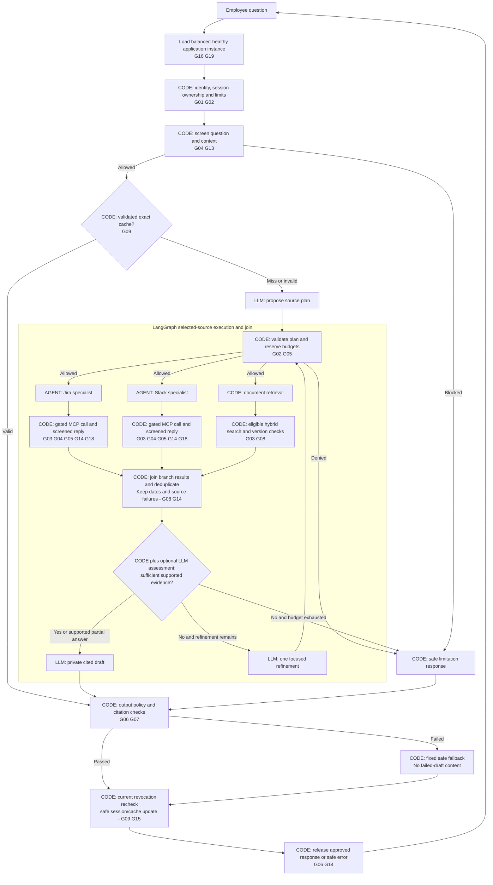
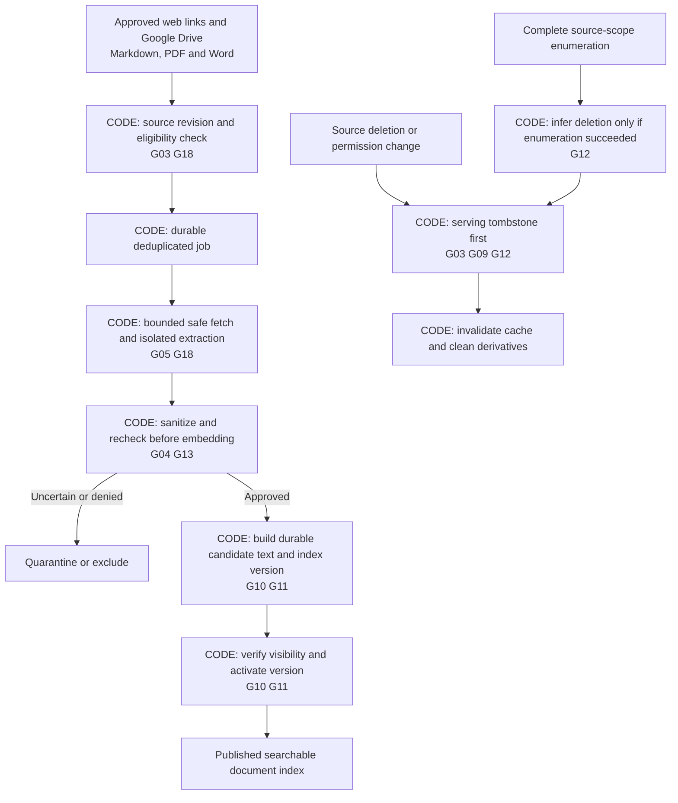
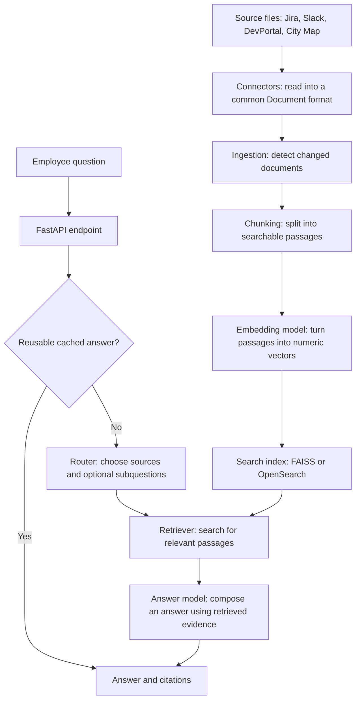

# Detailed workflow reference

Start with the [plain-language workflow](workflow.md). This page retains the
expanded control diagrams and original implementation for later engineering review.

Updated September 29, 2026. The target design below is **proposed, not implemented**.
The existing workflow is preserved at the end for comparison. Gap IDs link to the
[gap register](architecture/gap-register.md), which records evidence and acceptance checks.

Read the [HLD](architecture/high-level-design.md),
[service LLD](architecture/low-level-design.md), and
[LangGraph node guide](architecture/langgraph-nodes.md) for details.

## Target question workflow, with concrete gaps

Legend: **CODE** means ordinary programmed behavior; **LLM** means a bounded model
task; **AGENT** means a specialist with a bounded model/tool/observation loop.
Policy screening can use approved classifiers, but authorization stays in code.

The diagram expands subgraph internals for teaching; the precise parent-node and
specialist-loop boundaries are in the [node guide](architecture/langgraph-nodes.md).
Source wrappers not selected by the plan return `skipped` without model/tool calls.
Failures return explicit envelopes so the join does not wait forever. Tool gates
apply to every tool call inside each agent loop, not just the first call.

All proposed guards in this flow are currently open work. Input rejection and
graph failures also use safe terminal handling; a request does not need to reach
answer generation to complete. Unavailable mandatory policy checks block release.

The first protected version proposes safe progress events immediately and answer
release only after whole-draft checking. This changes raw answer-token streaming
and requires agreement before implementation. No raw graph state, tool replies,
draft tokens or model reasoning may be forwarded to the client.

## Required document workflow

Unchanged text skips unnecessary embeddings, but permission/redaction/processing
version changes are still handled. Extraction failure is not proof of source
deletion. New active versions are published without deleting the old eligible
version first. Tombstones override all versions and cache entries.

## Controls spanning every service

| Workflow area | Concrete gap IDs | Control location |
|---|---|---|
| Identity and request admission | G01 G02 | API and shared budget ledger |
| Access, injection and sensitive content | G03 G04 G05 | Policy module and every tool/model adapter |
| Evidence and checked output | G06 G07 G08 | Evidence service and answer release |
| Cache and session safety | G09 G15 | Dependency-aware cache, owner-bound temporary state |
| Publication and deletion | G10 G11 G12 | Ingestion jobs, version metadata and tombstones |
| Logs, failures and readiness | G13 G14 G16 | Safe telemetry, typed errors and live health checks |
| Secure releases and real integrations | G17 G18 | Deployment profile, MCP and document contracts |
| Shared limits and measured reliability | G19 G20 | Capacity controls, security/quality/load/recovery tests |

Every gap has an owner and a closure test in the
[gap register](architecture/gap-register.md). A diagram box is not evidence that
the control exists; tests and observed behavior must establish that.

## Existing implementation, before this redesign

This diagram describes the original high-level code flow. The connectors use
sample source files. It is a learning reference, not a production-readiness claim.

## How to read it

**Ingestion prepares the knowledge before questions arrive.** Connectors normalize
different source formats into documents. The pipeline checks for changes, splits
documents into passages, and embeds those passages for search. Unchanged documents
are skipped. Preparing the index in advance avoids reading every document for
every question.

**The question flow finds evidence and explains it.** The API checks its answer
cache first. On a cache miss, the agent runs `route → retrieve → synthesize`.
Retrieval embeds the question or subquestions, searches the index, and filters
results by relevance. If no evidence survives, synthesis returns an unsupported-
answer message without calling the answer model. Otherwise, the model composes
an answer from the evidence, with citations.

For example, “Who owns the Payments service?” can be routed to ownership data.
The retriever finds relevant passages, and the answer uses those passages as
evidence. Retrieval finds evidence; generation explains it. Both need evaluation.

`/ask` returns the completed result. `/ask/stream` sends progress and answer text
as processing proceeds, followed by the final result and citations. Successful
results can be cached for later questions. Cache writes and detailed error paths
are omitted from the diagram for readability.

## Where this lives in the code

| Component | Starting point |
|-----------|----------------|
| Common document format | [src/models/document.py](../src/models/document.py) |
| Source connectors | [src/connectors/](../src/connectors/) |
| Change detection and ingestion | [src/ingestion/pipeline.py](../src/ingestion/pipeline.py) |
| Passage splitting | [src/ingestion/chunking.py](../src/ingestion/chunking.py) |
| Search backend selection | [src/vectorstore/factory.py](../src/vectorstore/factory.py) |
| API and streaming | [src/api/main.py](../src/api/main.py) |
| Answer cache | [src/api/cache.py](../src/api/cache.py) |
| Agent workflow wiring | [src/agent/graph.py](../src/agent/graph.py) |
| Routing and answer generation | [src/agent/nodes.py](../src/agent/nodes.py) |
| Evidence retrieval | [src/retrieval/retriever.py](../src/retrieval/retriever.py) |

Employee sign-in, enforced source eligibility, and sensitive-content sanitization
are production requirements from the handoff; this diagram does not represent
them as implemented. The five-second completion target remains unverified.
