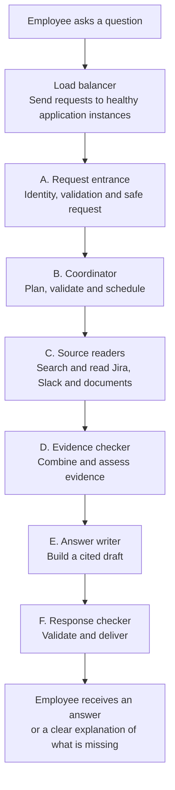
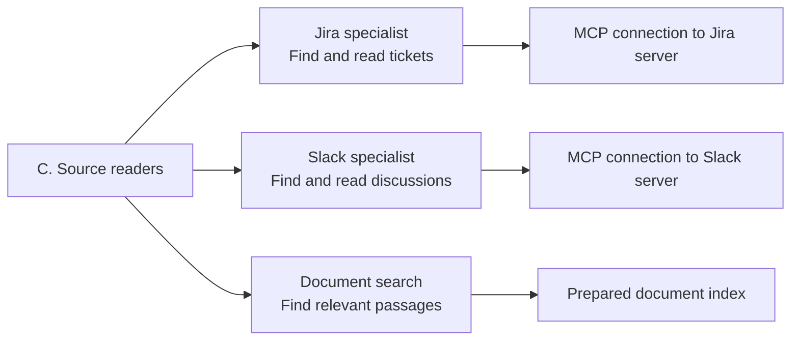
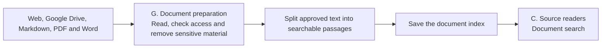

# Start here: what this project does

This project is an internal engineering assistant. An employee asks a question;
the assistant finds information in Jira, Slack and company documents, then gives
an explanation with links to the sources.

For example:

> Why is the Payments release delayed, and where is its rollout guide?

The goal is to save an employee from searching several systems and comparing the
results manually. The assistant must say when it cannot find a supported answer.

**Status:** this is the proposed redesign. The current project has an indexed-data
workflow. Live MCP specialists and the new guardrails are not yet implemented.
We will learn using realistic fake data first.

## 1. The whole question workflow

Use the same six names everywhere: **A. Request entrance**, **B. Coordinator**,
**C. Source readers**, **D. Evidence checker**, **E. Answer writer**, and
**F. Response checker**. They are parts of our application, not necessarily
separate servers.



This diagram shows the normal path. A request can stop earlier if access is
denied or a required service fails. Missing evidence produces an honest limitation
message. We will explain retry details later; they do not change these six jobs.

The **load balancer** distributes incoming requests across healthy copies of the
application. The selected copy runs the A–F workflow for that request. It is
infrastructure before the workflow, not a LangGraph agent or node. We can begin
locally with one copy and add more copies when measured traffic requires them.

## 2. Follow one question through the six parts

The following ticket and conversation facts are illustrative fake data.

| Part | What happens to our Payments question? |
|---|---|
| **Load balancer** | Sends the Payments question to a healthy application instance. |
| **A. Request entrance** | Checks the employee is signed in, the question is within size limits, and input is safe to process. |
| **B. Coordinator** | Decides Jira may explain ticket status, Slack may explain the discussion, and documents may contain the rollout guide. |
| **C. Source readers** | Finds a fake ticket saying "Blocked", a fake discussion about a failing release test, and passages from the rollout guide. |
| **D. Evidence checker** | Combines these results, preserves dates and links, and checks whether the delay and guide questions are supported. |
| **E. Answer writer** | Drafts: "The release is blocked while the failing test is resolved. The rollout guide is here," with links to supporting records. |
| **F. Response checker** | Checks the draft for sensitive information and unsupported citations before releasing it. |

If Slack is unavailable, we do not invent what the team discussed. We can explain
the Jira status and provide the guide while saying the discussion could not be checked.

## 3. What is inside C. Source readers?



**MCP** is a standard way for our application to call tools provided by another
server. Our local Jira and Slack servers will implement the actual protocol, but
return synthetic tickets and conversations. The server supplies records; our
application decides how to use them to answer the question.

**Document search** looks through a prepared index of approved web pages, Google
Drive content, Markdown, PDFs and Word documents. An index is stored information
organized for searching. Relevant passages and their locations come back to the
application. Document retrieval is required, although an individual question
may only need Jira or Slack.

Every source reader checks its allowed tools and source scope. Returned material
is screened before it can be shown to a model or saved in workflow state. The later
evidence checker does not replace these earlier access and screening checks.

## 4. Documents are prepared separately

We call this supporting part **G. Document preparation**. It runs before and
between questions, so employees do not wait for entire PDFs to be processed.



Changed documents are processed again; unchanged text avoids unnecessary work.
Deleted or newly restricted documents must stop being served. Jira and Slack use
live MCP reads in the proposed design instead of this full document-indexing path.

## 5. Where LangGraph and guardrails fit

**LangGraph runs the steps inside the application.** We give it functions for
planning, source reading, evidence checking and answer creation. It carries the
working information between them and follows the routes we define. It can run
independent source readers together and wait for their results.

The Jira and Slack specialists are **agents** because each can choose a read tool,
inspect its screened result, and decide whether another read is needed. The planner
and answer writer are **single-purpose model calls**. Access checks, searching the
document index, budgets and response release are **ordinary code**.

**Guardrails** are checks that limit what the system may access, do, and reveal:

| Where | Plain-language rule |
|---|---|
| A. Request entrance | Only authorized employees can use the service; screen the input. |
| B. Coordinator | A model cannot ask for unlimited searches or expand access. |
| C. Source readers | Use approved read tools and only company-wide eligible, screened information. |
| D. Evidence checker | Preserve source information, dates and limitations; assess what is supported. |
| E. Answer writer | Use approved evidence; the writer has no source tools. |
| F. Response checker | Withhold unsafe or unsupported output. |
| G. Document preparation | Screen content before indexing and handle removal or permission changes. |

Permission checks are enforced by code. Models can help assess content and support,
but those assessments can make mistakes and do not grant permission.

We propose showing progress immediately and releasing answer text after checking
the complete draft. This differs from the current raw token stream and still needs
agreement before implementation.

## 6. How this connects to HLD and LLD

**HLD (high-level design)** shows these seven parts, their responsibilities, and
their connections. **LLD (low-level design)** opens each of the same parts and
explains its inputs, functions and outputs.

For example:

```text
Workflow: C. Source readers finds a Jira ticket.
HLD:      C contains a Jira specialist connected to a Jira MCP server.
LLD:      The specialist proposes get_issue("PAY-123").
          Code checks permission, calls MCP, and screens the result.
          It returns approved ticket evidence or a clear failure status.
```

They describe the same system at different levels of detail. Start with the
[HLD](architecture/high-level-design.md), then read the matching letters in the
[LLD](architecture/low-level-design.md). The [expanded workflow](workflow-reference.md)
and [gap register](architecture/gap-register.md) are references for later.
